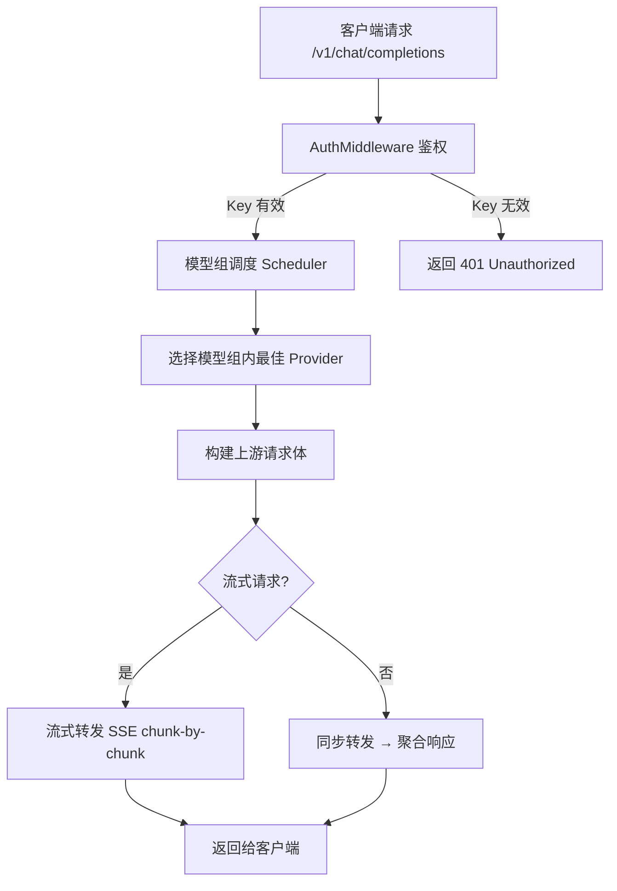
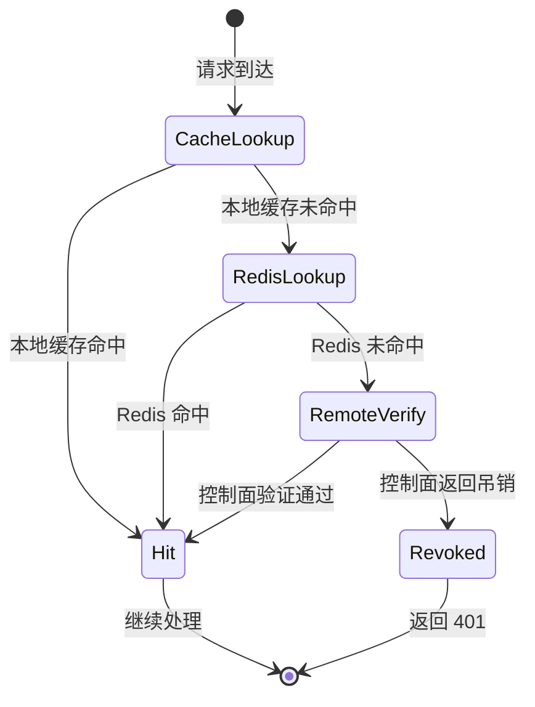

# gateway-core 需求规范

## 0. 文档信息

| 属性 | 内容 |
| :--- | :--- |
| **所属变更** | baseline-v1.0 |
| **模块名称** | gateway-core |
| **模块类型** | web-backend |
| **创建时间** | 2026-06-03 |

### 修订记录

| 版本号 | 修改日期 | 修改内容摘要 | 修改人 |
| :--- | :--- | :--- | :--- |
| v1.0 | 2026-06-03 | 基线初稿，记录已实现的 v1.0 能力 | Sisyphus |

---

## 1. 业务背景与系统目标

LLM Gateway 的核心转发引擎。作为公司大模型统一入口的数据面服务，对外暴露 OpenAI 兼容的 `/v1/*` 接口，对内将请求按「模型组→具体厂商」路由分发，实现厂商无关的模型调度。

- **业务背景**：公司需要统一的 LLM 入口替代 LiteLLM，实现组织架构匹配、国产厂商适配、安全可控
- **核心目标**：构建一个高性能、低延迟的请求转发核心，支持鉴权→模型组调度→provider 路由→流式转发的全链路
- **关键衡量指标**：
  - `/v1/*` 接口可用率 ≥ 99.9%
  - TTFT P95 延迟较 LiteLLM 下降 ≥ 30%
  - 支持 17+ 厂商无缝切换

---

## 2. 关键概念

- **API Key**：用户身份凭证，由控制面签发，网关负责验证。与用户 SSO 身份绑定，支持设备绑定监控
- **模型组 (Group)**：对外暴露的模型名（如 `gpt-4-level`），内部包含多个具体模型实例，按策略调度。实现业务与厂商解耦
- **Provider Router**：按模型名选择具体厂商 adapter 的路由器，通过 `providers.Router` 实现。配置变更时原子替换
- **ProviderLoader**：监听 Redis pub/sub `config:change` 事件，30s reconcile，原子重建 Provider Router 的热加载机制
- **KeyCache**：API Key 的双层缓存（本地内存 5s + Redis 15s），Key 吊销事件主动失效，避免每次请求远程调控制面
- **AuthMiddleware**：请求鉴权中间件，从 `Authorization: Bearer <key>` 提取 Key，调用 `AuthClient.VerifyKey` 验证

---

## 3. 超出范围

- 不负责 Key 的创建、吊销、权限管理（由 control-plane 负责）
- 不负责模型/渠道/模型组的 CRUD 管理（由 control-plane 负责）
- 不负责用量统计的持久化存储（由 control-plane 负责）
- 不直连 PostgreSQL 数据库，配置只走 Redis snapshot 和控制面内部 API
- 不负责 Prompt 管理、Agent 编排、RAG 等业务

---

## 4. 角色与权限控制 (RBAC)

| 角色名称 | 角色描述 | 操作权限 | 数据范围 |
| :--- | :--- | :--- | :--- |
| API 调用者 | 持有有效 API Key 的用户 | 调用 `/v1/chat/completions`、`/v1/models` 等 | 仅限 Key 关联的模型组 |
| 内部服务 | control-plane 内部调用 | 调用 `/internal/v1/auth/verify-key` | 内部双向认证 |
| 匿名用户 | 无凭证访问 | 仅 `/health`、`/ready` | 无 |

---

## 5. 业务流程与状态机

### 请求处理流程

### Key 验证状态机

---

## 6. 详细功能需求

### 6.1 API 鉴权

**A. 功能说明**

接收客户端请求中的 API Key（`Authorization: Bearer <key>`），通过双层缓存机制验证 Key 的有效性。验证失败返回 401，有效则提取关联的身份信息和模型组权限注入请求上下文。

**B. 接口概要**

| 接口 | 方法 | 路径 | 说明 |
| :--- | :--- | :--- | :--- |
| Health Check | GET | /health | 存活检查 |
| Readiness | GET | /ready | 就绪检查（含 Redis 连接状态）|
| List Models | GET | /v1/models | 返回当前 Key 有权限的模型列表 |
| Model Info | GET | /v1/model/info | 返回单个模型的详细信息 |
| Chat Completions | POST | /v1/chat/completions | OpenAI 兼容的聊天补全接口 |
| Embeddings | POST | /v1/embeddings | 文本嵌入接口 |
| Provider Proxy | POST | /v1/p/:provider/*path | 透传特定 Provider 的原生接口 |
| JWKS | GET | /.well-known/jwks.json | JWT 公钥集 |
| Token Refresh | POST | /auth/refresh | 刷新 JWT Token |
| Logout | POST | /auth/logout | 登出 |
| Verify Key | POST | /internal/v1/auth/verify-key | 内部 Key 验证接口（供自身调用）|

**D. 业务规则与校验**

- Key 必须以 `Bearer ` 前缀传递
- Key 验证失败 3 次不触发额外惩罚，由控制面统一管控
- KeyCache 本地 TTL 5s，Redis TTL 15s，Key 吊销通过 Redis pub/sub 事件主动失效

**E. 异常与边界**

- **并发处理**：KeyCache 使用读写锁保护，查询线程安全
- **控制面不可用**：使用本地缓存兜底，缓存过期后拒绝请求
- **Key 吊销延迟**：最长 30s（reconcile 周期 + Redis pub/sub 传播时间）

### 6.2 模型组调度

**A. 功能说明**

根据请求中的 `model` 参数查找对应的模型组，在组内的多个 Provider 实例中按调度策略选择一个最优的转发目标。

**C. 接口概要**

内部组件间接口，无对外 API。

**D. 业务规则与校验**

- 模型组内按可用性（健康检查通过）+ 延迟 + 报错率多维度决策选择 Provider
- 模型不存在时返回明确的错误信息（含可用模型列表提示）
- 模型组为空或无可用 Provider 时返回 503

**E. 异常与边界**

- **Provider 全部不可用**：返回 503 Service Unavailable + 详细错误信息
- **调度决策超时**：使用默认策略（轮询或首位可用），不阻塞请求

### 6.3 流式转发

**A. 功能说明**

对 SSE (Server-Sent Events) 流式请求，逐 chunk 从上游 Provider 读取并实时转发给客户端，不做缓冲。同时记录流式观测指标（TTFT、延迟、TPS）。

**E. 异常与边界**

- **上游断流**：正常结束当前连接，不额外缓冲或重试
- **客户端断开**：取消上游请求，释放资源
- **chunk 过大**：按 SSE 协议切割，确保每个 `data:` 行不超长

### 6.4 Provider 热加载

**A. 功能说明**

监听 Redis pub/sub `config:change` 事件，收到通知后重新加载 Provider 配置，原子替换 `providers.Router`。同时每 30s 做一次 reconcile，确保配置最终一致。

**D. 业务规则与校验**

- 配置加载失败时保留旧 Router，不降级到空配置
- 原子替换确保正在处理的请求不受影响
- 加载后输出变更日志（新增/删除/变更的 Provider）

---

## 7. 数据流与外部接口

- **配置获取**：通过 ProviderLoader 从 Redis snapshot 获取 provider 配置（`internal/configsync/snapshot.go`）
- **Key 验证**：通过 AuthClient POST 到控制面 `/internal/v1/auth/verify-key`（`internal/gateway/infra/auth_client.go`）
- **配置变更通知**：监听 Redis pub/sub `config:change` 频道

---

## 8. 非功能需求

- **性能**：请求热路径（鉴权→调度→转发）禁止同步 IO 阻塞或重量级计算；TTFT P95 < 300ms
- **安全性**：Key 传输走 HTTPS，日志不记录完整 Key，设备绑定监控
- **高可用**：单一厂商故障不导致网关整体不可用；配置热加载无需重启
- **可观测性**：OpenTelemetry OTLP 全链路追踪；TTFT / 延迟 / 报错率 / 缓存命中率指标

---

## 9. 验收标准

| 编号 | 关联 | Given（前置状态） | When（触发动作） | Then（预期结果） | 优先级 |
| :--- | :--- | :--- | :--- | :--- | :--- |
| AC-01 | 鉴权 | Given 用户持有有效 API Key | When 以 Bearer 方式携带 Key 请求 /v1/chat/completions | Then Key 验证通过，请求正常调度转发 | P0 |
| AC-02 | 鉴权 | Given 用户持有已吊销的 API Key | When 请求 /v1/chat/completions | Then 返回 401 Unauthorized，本地缓存同步失效 | P0 |
| AC-03 | 调度 | Given 模型组内有 3 个可用 Provider | When 收到对该模型组的请求 | Then 按可用性+延迟+报错率选择一个 Provider 转发 | P0 |
| AC-04 | 调度 | Given 模型组内所有 Provider 不可用 | When 收到对该模型组的请求 | Then 返回 503 Service Unavailable | P0 |
| AC-05 | 流式 | Given 上游 Provider 持续返回 SSE chunk | When 客户端发起流式请求 | Then 每个 chunk 实时转发，不缓冲完整响应 | P0 |
| AC-06 | 热加载 | Given 控制面更新了 Provider 配置并 pub 事件 | When Gateway 收到 config:change 通知 | Then 30s 内原子重建 Router，正在处理的请求不受影响 | P1 |
| AC-07 | 热加载 | Given Provider 配置加载失败 | When 触发热加载 | Then 保留旧 Router 继续服务，不降级到空配置 | P1 |

---

## 10. 假设与依赖

- 假设控制面服务可用，Redis 稳定运行
- 依赖 `provider-adapters` 模块提供正确的 `core.Provider` 实现
- 依赖 `control-plane` 模块提供 `/internal/v1/auth/verify-key` 和 Redis snapshot 写入
- 依赖 Redis pub/sub 消息可靠传递