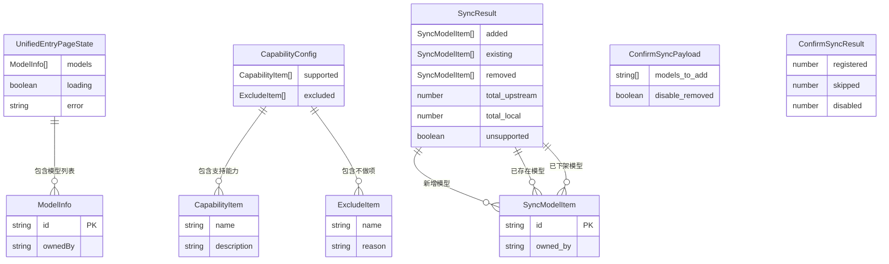
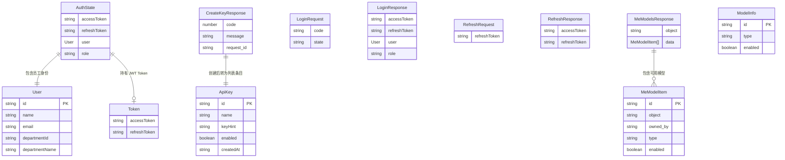

# ops-console 数据模型

## 1. 文档概述

| 属性 | 内容 |
| :--- | :--- |
| **所属变更** | CHG-20260521-001 |
| **模块名称** | ops-console |
| **模块类型** | web-frontend |
| **创建时间** | 2026-05-21 |
| **修改人** | OpenCode |

### 修订记录

| 版本号 | 修改日期 | 修改内容摘要 | 修改人 |
| :--- | :--- | :--- | :--- |
| v1.0 | 2026-05-21 | 初稿创建 | OpenCode |
| v1.1 | 2026-05-23 | 新增 SyncResult / ConfirmSyncPayload 等同步模型类型（CHG-20260521-002） | OpenCode |
| v1.2 | 2026-05-25 | 新增 AuthState / KeysState / MeModelsState 前端状态 — CHG-20260523-001 | OpenCode |

本文档定义 ops-console 统一接入页面的前端数据结构，包括静态配置实体、API 响应类型、以及页面本地状态类型。所有类型均以 TypeScript interface 形式描述，作为前端开发的类型约束依据。

---

## 2. 核心实体

### 2.1 能力配置（CapabilityConfig）

```typescript
/** 能力说明完整配置，对应 src/config/capability.json */
interface CapabilityConfig {
  /** 本次支持的能力列表 */
  supported: CapabilityItem[]
  /** 明确不做项列表 */
  excluded: ExcludeItem[]
}
```

### 2.2 能力项（CapabilityItem）

```typescript
/** 单项支持能力 */
interface CapabilityItem {
  /** 能力名称，如"OpenAI 兼容接口" */
  name: string
  /** 能力描述，简述该能力涵盖的内容 */
  description: string
}
```

### 2.3 不做项（ExcludeItem）

```typescript
/** 单项不做项 */
interface ExcludeItem {
  /** 不做项名称，如"Prompt 管理" */
  name: string
  /** 不做的原因说明 */
  reason: string
}
```

### 2.4 模型信息（ModelInfo）

```typescript
/** 前端展示用模型信息，从 /v1/models 响应映射而来 */
interface ModelInfo {
  /** 模型唯一标识，即模型名称，如"gpt-4o"、"qwen-turbo" */
  id: string
  /** 归属厂商，如"openai"、"alibaba" */
  ownedBy: string
}
```

### 2.5 同步模型条目（SyncModelItem）

```typescript
/** 同步结果中的模型条目 */
interface SyncModelItem {
  id: string
  owned_by: string
}
```

### 2.6 同步结果（SyncResult）

```typescript
/** 同步模型接口返回结果 */
interface SyncResult {
  added: SyncModelItem[]
  existing: SyncModelItem[]
  removed: SyncModelItem[]
  total_upstream: number
  total_local: number
  unsupported: boolean
}
```

### 2.7 确认注册请求体（ConfirmSyncPayload）

```typescript
/** 确认注册请求体 */
interface ConfirmSyncPayload {
  models_to_add: string[]
  disable_removed?: boolean
}
```

### 2.8 确认注册结果（ConfirmSyncResult）

```typescript
/** 确认注册返回结果 */
interface ConfirmSyncResult {
  registered: number
  skipped: number
  disabled: number
}
```

---

## 3. 数据关系



**关系说明**：

| 主体 | 关系 | 客体 | 基数 |
| :--- | :--- | :--- | :--- |
| UnifiedEntryPageState | 包含 | ModelInfo | 0..N |
| CapabilityConfig | 包含 | CapabilityItem | 1..N |
| CapabilityConfig | 包含 | ExcludeItem | 1..N |
| SyncResult | 包含 | SyncModelItem (added) | 0..N |
| SyncResult | 包含 | SyncModelItem (existing) | 0..N |
| SyncResult | 包含 | SyncModelItem (removed) | 0..N |
| ConfirmSyncPayload | 引用 | SyncModelItem.id | 0..N |

---

## 4. 请求/响应类型

### 4.1 GET /v1/models 请求

本接口无请求参数，认证通过浏览器自动携带的 JWT Cookie 完成。

```typescript
/** GET /v1/models 请求配置（无 body/params） */
interface FetchModelsRequest {
  method: 'GET'
  url: '/v1/models'
  headers: {
    Accept: 'application/json'
    // Cookie 由浏览器自动携带，无需显式设置
  }
}
```

### 4.2 GET /v1/models 成功响应

遵循 OpenAI Models List API 格式：

```typescript
/** /v1/models 接口原始响应 */
interface ModelsListResponse {
  /** 固定值 "list" */
  object: 'list'
  /** 模型对象数组 */
  data: ModelsListItem[]
}

/** 单个模型原始数据（OpenAI 格式） */
interface ModelsListItem {
  /** 模型唯一标识（模型名称） */
  id: string
  /** 固定值 "model" */
  object: 'model'
  /** 模型创建时间戳（Unix 秒） */
  created: number
  /** 归属厂商标识（snake_case） */
  owned_by: string
}
```

### 4.3 GET /v1/models 错误响应

```typescript
/** 错误响应结构 */
interface ModelsErrorResponse {
  error: {
    /** 错误描述信息 */
    message: string
    /** 错误类型标识 */
    type: 'auth_error' | 'permission_error' | 'server_error'
  }
}
```

### 4.4 响应映射函数

```typescript
/** 将 API 原始响应映射为前端 ModelInfo 数组 */
function mapModelsResponse(response: ModelsListResponse): ModelInfo[] {
  return response.data.map(item => ({
    id: item.id,
    ownedBy: item.owned_by
  }))
}
```

**字段映射规则**：

| 原始字段路径 | 目标字段 | 映射方式 |
| :--- | :--- | :--- |
| data[].id | ModelInfo.id | 直接赋值 |
| data[].owned_by | ModelInfo.ownedBy | snake_case 转 camelCase |
| data[].object | 不映射 | 前端不使用 |
| data[].created | 不映射 | 前端不使用 |

---

## 5. 本地状态类型

### 5.1 页面状态（UnifiedEntryPageState）

```typescript
/** 统一接入页面整体状态 */
interface UnifiedEntryPageState {
  /** 模型列表数据，初始为空数组 */
  models: ModelInfo[]
  /** 是否正在加载模型列表，初始为 false */
  loading: boolean
  /** 错误信息，null 表示无错误，初始为 null */
  error: string | null
}
```

### 5.2 状态初始值

```typescript
const initialState: UnifiedEntryPageState = {
  models: [],
  loading: false,
  error: null
}
```

### 5.3 状态变更场景

| 场景 | models | loading | error |
| :--- | :--- | :--- | :--- |
| 初始状态 | [] | false | null |
| 发起请求 | [] | true | null |
| 请求成功（有数据） | ModelInfo[] | false | null |
| 请求成功（无数据） | [] | false | null |
| 请求失败（403） | [] | false | "暂无权限查看模型信息" |
| 请求失败（500/503） | [] | false | "服务暂时不可用，请稍后重试" |
| 请求失败（网络异常） | [] | false | "网络异常，请刷新重试" |
| 点击刷新 | [] | true | null |


---

## 6. 变更记录 — CHG-20260523-001

## 变更摘要

新增员工身份认证相关类型（AuthState、User、LoginRequest、LoginResponse、RefreshRequest、RefreshResponse）、Key 管理相关类型（ApiKey、CreateKeyResponse）、模型可用查询响应类型（ModelInfo 扩展 /v1/me/models 适配）。所有类型以 TypeScript interface 形式定义，作为前端类型约束依据。

---

## 新增实体

### AuthState — 认证状态

```typescript
/** Pinia AuthStore 状态 */
interface AuthState {
  /** JWT access token，用于 Bearer 认证 */
  accessToken: string | null
  /** JWT refresh token，用于续期 accessToken */
  refreshToken: string | null
  /** 当前登录用户身份信息 */
  user: User | null
  /** 用户角色 */
  role: 'employee' | 'admin' | null
}
```

### User — 用户身份

```typescript
/** 员工身份信息 */
interface User {
  /** 员工唯一标识 */
  id: string
  /** 员工姓名 */
  name: string
  /** 员工邮箱 */
  email: string
  /** 所属部门 ID */
  departmentId: string
  /** 所属部门名称 */
  departmentName: string
}
```

### ApiKey — API Key（列表展示用，已脱敏）

```typescript
/** Key 列表条目，从 GET /api/v1/keys 响应映射 */
interface ApiKey {
  /** Key 唯一标识 */
  id: string
  /** Key 名称（用户自定义） */
  name: string
  /** Key 脱敏提示，仅末尾 4 位可见，格式："****abcd" */
  keyHint: string
  /** 是否启用 */
  enabled: boolean
  /** 创建时间（ISO 8601 字符串） */
  createdAt: string
}
```

### CreateKeyResponse — 创建 Key 响应

```typescript
/** POST /api/v1/keys 成功响应，包含 Key 明文 */
interface CreateKeyResponse {
  code: number
  message: string
  data: {
    /** 新创建的 Key 唯一标识 */
    id: string
    /** Key 名称 */
    name: string
    /** Key 明文，以 sk- 开头，仅此次返回，后续不可查询 */
    key: string
    /** Key 末尾 4 位 */
    key_hint: string
    enabled: boolean
    created_at: string
    updated_at: string
  }
  request_id: string
}
```

### LoginRequest — OIDC 回调请求

```typescript
/** POST /auth/oidc/callback 请求体 */
interface LoginRequest {
  /** SSO 回调携带的授权码 */
  code: string
  /** SSO 回调携带的 state 参数（防 CSRF） */
  state: string
}
```

### LoginResponse — OIDC 回调响应

```typescript
/** POST /auth/oidc/callback 成功响应 */
interface LoginResponse {
  /** JWT access token */
  accessToken: string
  /** JWT refresh token */
  refreshToken: string
  /** 员工身份信息 */
  user: User
  /** 用户角色 */
  role: 'employee' | 'admin'
}
```

### RefreshRequest — Token 刷新请求

```typescript
/** POST /auth/refresh 请求体 */
interface RefreshRequest {
  /** 当前有效的 refresh token */
  refreshToken: string
}
```

### RefreshResponse — Token 刷新响应

```typescript
/** POST /auth/refresh 成功响应 */
interface RefreshResponse {
  /** 新的 JWT access token */
  accessToken: string
  /** 新的 JWT refresh token（滚动刷新） */
  refreshToken: string
}
```

### ModelInfo（扩展）— 模型信息（/v1/me/models 适配）

```typescript
/**
 * 可用模型信息，从 /v1/me/models 响应映射
 * 相比已有 ModelInfo（/v1/models），新增 type 字段描述模型类型
 */
interface ModelInfo {
  /** 模型唯一标识 */
  id: string
  /** 模型类型：chat / completion / embedding / image / audio */
  type: 'chat' | 'completion' | 'embedding' | 'image' | 'audio'
  /** 是否可用（当前身份可调用） */
  enabled: boolean
}
```

### /v1/me/models 响应

```typescript
/** GET /v1/me/models 原始响应 */
interface MeModelsResponse {
  /** 固定为 list */
  object: 'list'
  /** 当前身份可用的模型列表 */
  data: MeModelItem[]
}

interface MeModelItem {
  /** 模型名称（唯一标识） */
  id: string
  /** OpenAI 兼容固定值 */
  object: 'model'
  /** 提供方标识 */
  owned_by: string
  /** 模型类型 */
  type: string
  /** 是否启用 */
  enabled: boolean
}
```

### /api/v1/keys 列表响应映射函数

```typescript
interface ListKeysResponse {
  code: number
  message: string
  data: {
    items: RawKeyItem[]
    total: number
    page: number
    page_size: number
  }
  request_id: string
}

/** 将 control-plane 原始响应映射为前端 ApiKey 数组 */
function mapKeysResponse(response: ListKeysResponse): ApiKey[] {
  return response.data.items.map(item => ({
    id: item.id,
    name: item.name,
    keyHint: item.key_hint,
    enabled: item.enabled,
    createdAt: item.created_at
  }))
}

interface RawKeyItem {
  id: string
  name: string
  masked_key: string
  key_hint: string
  enabled: boolean
  created_at: string
  updated_at: string
}
```

### 字段映射规则（新增）

| 原始字段路径 | 目标字段 | 映射方式 |
| :--- | :--- | :--- |
| data.items[].id | ApiKey.id | 直接赋值 |
| data.items[].name | ApiKey.name | 直接赋值 |
| data.items[].key_hint | ApiKey.keyHint | snake_case 转 camelCase |
| data.items[].enabled | ApiKey.enabled | 直接赋值 |
| data.items[].created_at | ApiKey.createdAt | snake_case 转 camelCase |

---

## 数据关系



**新增关系说明**：

| 主体 | 关系 | 客体 | 基数 | 说明 |
| :--- | :--- | :--- | :--- | :--- |
| AuthState | 包含 | User | 1..1 | 每个登录态对应唯一用户身份 |
| AuthState | 持有 | Token | 1..1 | accessToken + refreshToken 配对 |
| CreateKeyResponse | 创建后转为 | ApiKey | 1..1 | 创建成功后丢弃 `data.key` 明文，仅保留脱敏条目 |
| MeModelsResponse | 包含 | MeModelItem | 0..N | 当前身份可用的模型列表 |
| LoginRequest | 兑换为 | LoginResponse | 1..1 | OIDC code → 身份 + token |
| RefreshRequest | 兑换为 | RefreshResponse | 1..1 | refreshToken → 新 token 对 |

---

## 本地状态类型（新增）

### AuthStore 持久化存储结构

```typescript
/** localStorage 中 AuthStore 的持久化键 */
const AUTH_STORAGE_KEY = 'ops-console:auth'

/** 持久化到 localStorage 的数据子集 */
interface AuthPersistedState {
  accessToken: string
  refreshToken: string
  user: User
  role: 'employee' | 'admin'
}
```

### KeyListPage 状态

```typescript
interface KeyListPageState {
  keys: ApiKey[]
  loading: boolean
  error: string | null
}
```

### KeyCreateDialog 状态

```typescript
interface KeyCreateDialogState {
  visible: boolean
  name: string
  submitting: boolean
  createdKey: CreateKeyResponse | null
  plaintextCopied: boolean
}
```

### ModelListPage 状态

```typescript
interface ModelListPageState {
  models: ModelInfo[]
  loading: boolean
  error: string | null
}
```

### HomePage 状态

```typescript
interface HomePageState {
  hasKeys: boolean
  hasModels: boolean
  keysLoading: boolean
  modelsLoading: boolean
}
```

### 状态初始值

```typescript
const initialKeyListPageState: KeyListPageState = {
  keys: [],
  loading: false,
  error: null
}

const initialKeyCreateDialogState: KeyCreateDialogState = {
  visible: false,
  name: '',
  submitting: false,
  createdKey: null,
  plaintextCopied: false
}

const initialModelListPageState: ModelListPageState = {
  models: [],
  loading: false,
  error: null
}

const initialHomePageState: HomePageState = {
  hasKeys: false,
  hasModels: false,
  keysLoading: true,
  modelsLoading: true
}
```
