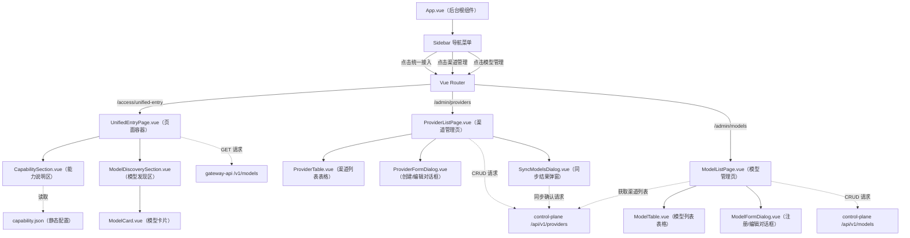
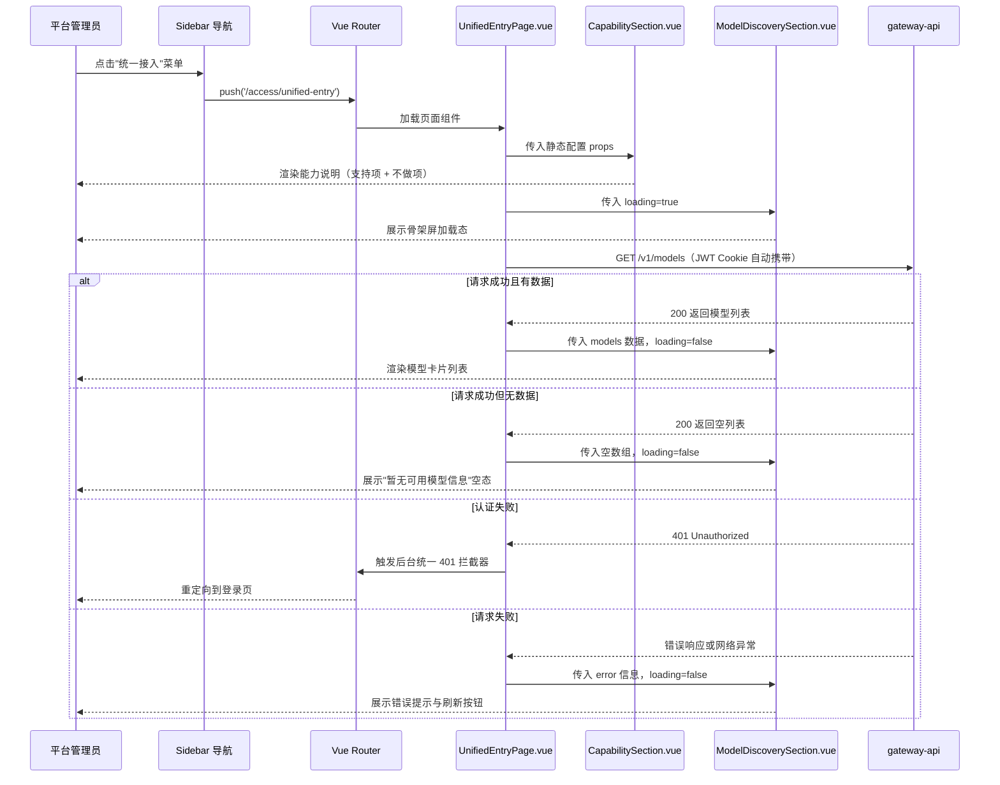
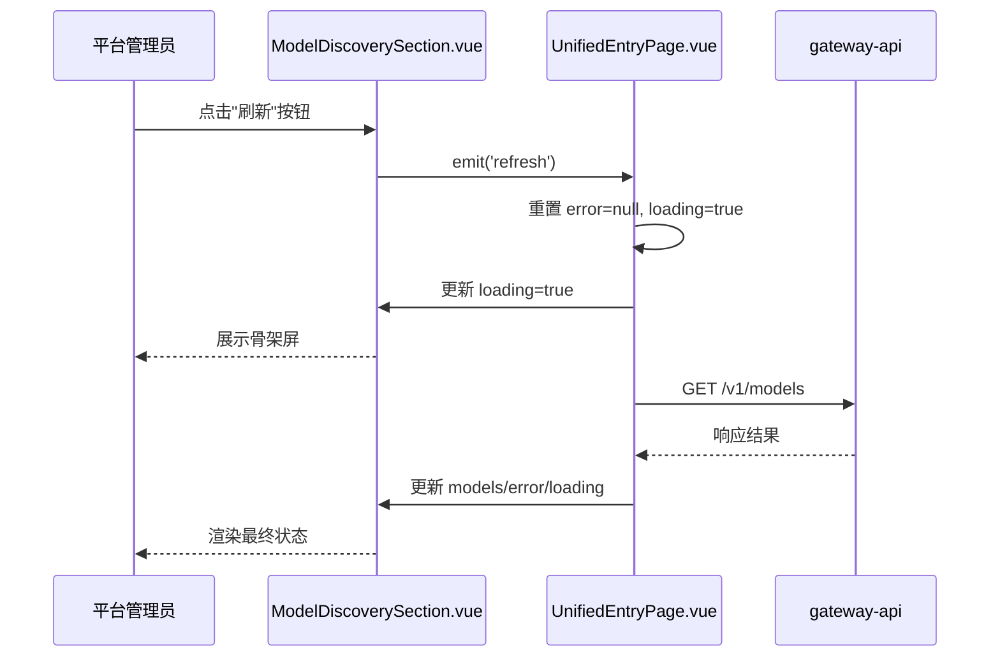
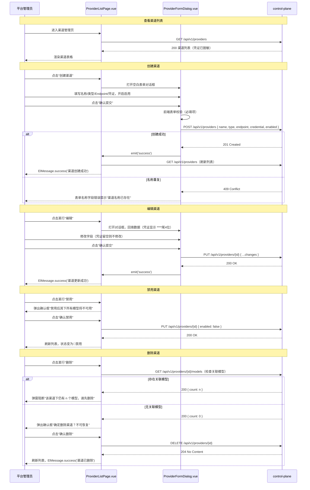
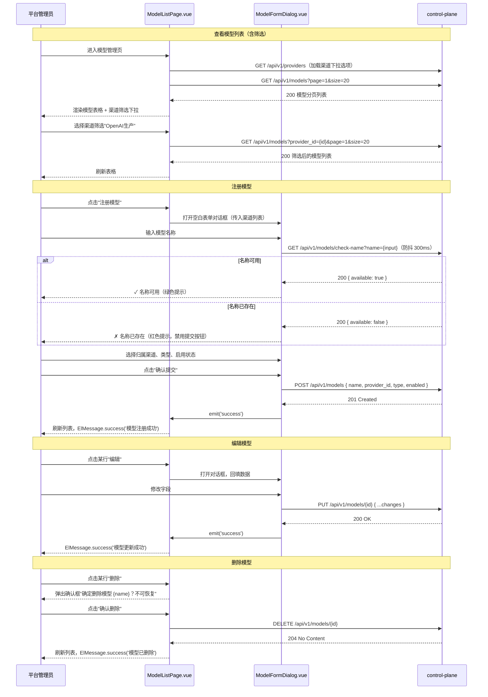
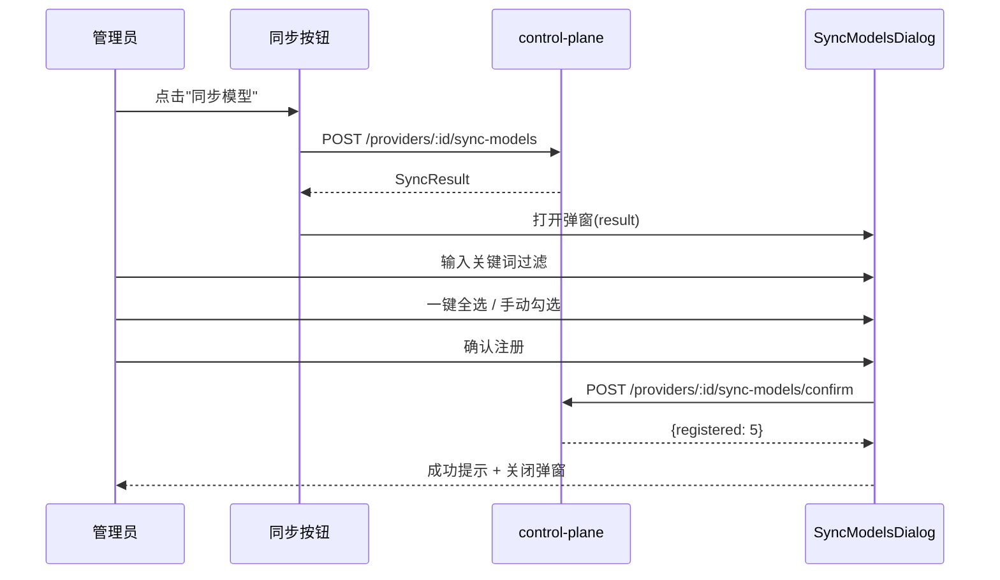
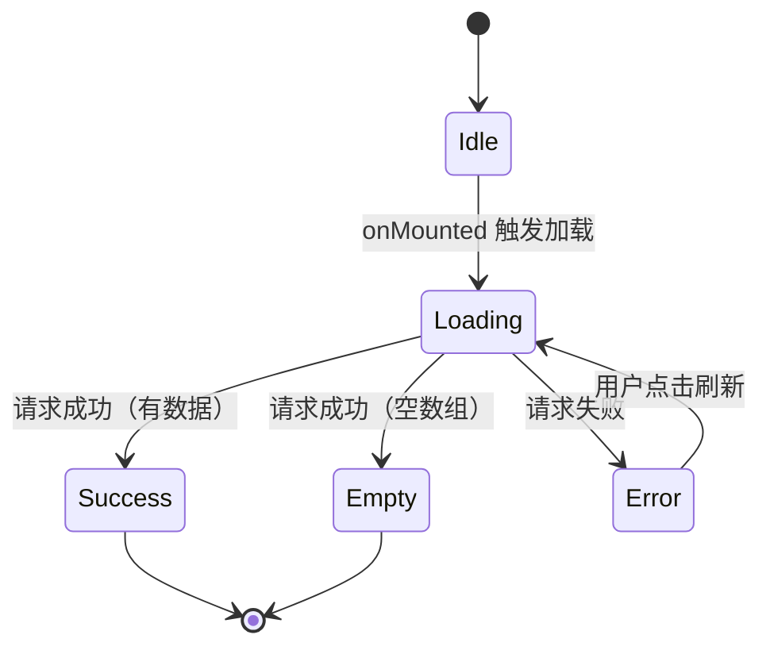
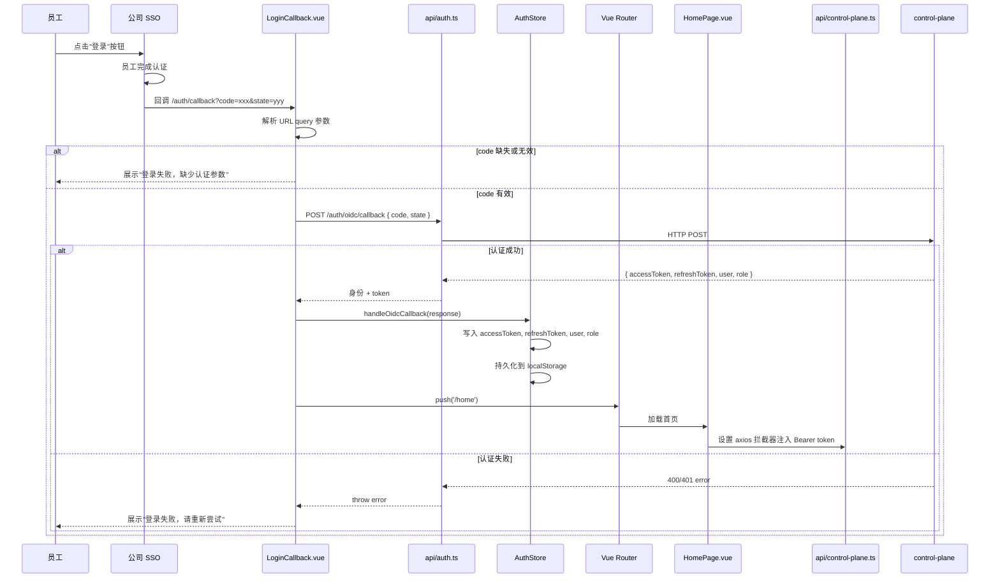
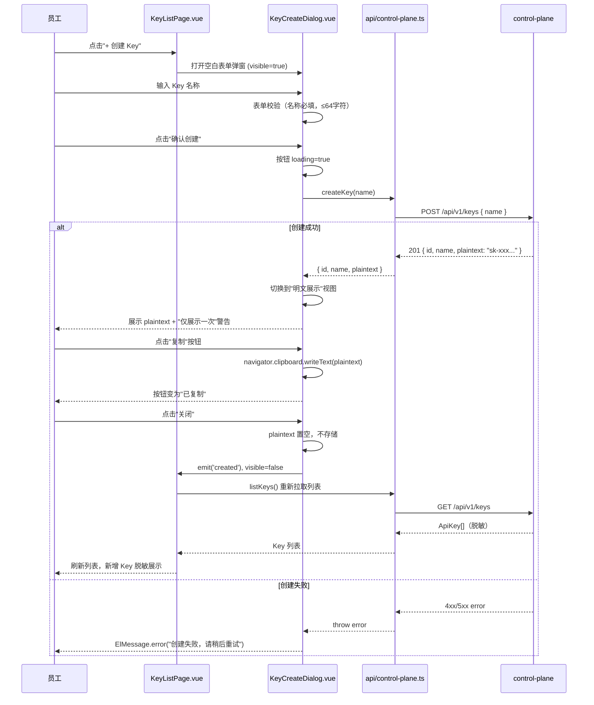
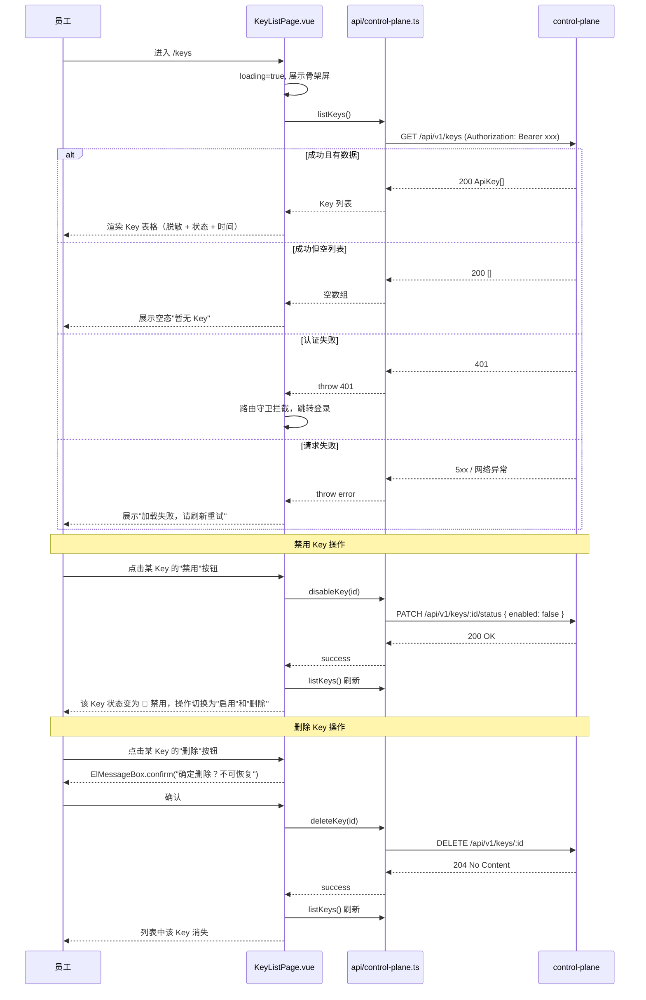

# ops-console 详细设计

## 0. 文档信息

| 属性 | 内容 |
| :--- | :--- |
| **所属变更** | CHG-20260521-001 |
| **模块名称** | ops-console |
| **模块类型** | web-frontend |
| **创建时间** | 2026-05-21 |
| **修改人** | OpenCode |

### 修订记录

| 版本号 | 修改日期 | 修改内容摘要 | 修改人 |
| :--- | :--- | :--- | :--- |
| v1.0 | 2026-05-21 | 初稿创建 | OpenCode |
| v1.1 | 2026-05-23 | 新增渠道管理页、模型管理页（CHG-20260521-002） | OpenCode |
| v1.2 | 2026-05-25 | 新增员工自服务页面详细设计 — CHG-20260523-001 | OpenCode |

---

## 1. 背景与目标

### 1.1 业务背景

公司统一大模型网关（llm-gateway）需要一个管理后台入口，让平台管理员快速了解网关统一接入能力范围，并实时查看当前可用模型列表。本模块为 ops-console 中的"统一接入"菜单页，是管理后台的新增页面。

### 1.2 设计目标

- 提供统一接入能力说明的可视化展示，包含支持能力列表和明确不做项列表
- 提供模型发现承接区，实时展示 gateway-api 当前注册的可用模型
- 页面以信息展示为主，交互简洁，加载快速
- 复用后台已有认证和导航框架，零额外基础设施开销

### 1.3 非目标

- 不涉及模型的创建、编辑、删除等管理操作
- 不涉及 Prompt 管理、Agent 编排等功能
- 不涉及用量配额与限流配置

---

## 2. 模块职责边界

| 维度 | 范围 |
| :--- | :--- |
| 所属系统 | ops-console（运维管理后台） |
| 页面路由 | /access/unified-entry |
| 核心职责 | 展示统一接入能力说明（静态）+ 展示可用模型列表（动态） |
| 数据来源 | 能力说明：前端静态 JSON 配置；模型列表：GET /v1/models（gateway-api） |
| 认证方式 | 复用后台 SSO + JWT Cookie，无额外认证逻辑 |
| 与其他模块关系 | 作为 gateway-api 的前端消费方，仅读取数据不写入 |
| 不负责 | 模型管理 CRUD、权限配置、日志审计、监控告警 |

---

## 3. 技术选型

| 类别 | 选型 | 版本 | 选型理由 |
| :--- | :--- | :--- | :--- |
| 框架 | Vue 3 | 3.x | 后台系统统一技术栈 |
| 语言 | TypeScript | 5.x | 类型安全，提升代码可维护性 |
| UI 组件库 | Element Plus | 最新稳定版 | 后台系统统一组件库 |
| 构建工具 | Vite | 5.x | 开发体验好，构建速度快 |
| 状态管理 | Pinia（备选） | 最新稳定版 | 本页面状态简单，实际使用组件内 ref 管理 |
| 路由 | Vue Router | 4.x | 后台系统统一路由方案 |
| HTTP 客户端 | Axios | 1.x | 后台系统统一 HTTP 库，含拦截器机制 |

---

## 4. 界面设计

### 4.1 整体布局结构

页面运行在后台管理系统的主内容区内，左侧为导航栏，右侧为内容区。采用 12 列网格布局，间距为 8px 倍数。

```
┌──────────┬──────────────────────────────────────────────────────┐
│          │                                                      │
│  后台    │  主内容区                                             │
│  Sidebar │  ┌──────────────────────────────────────────────┐   │
│          │  │  页面标题：统一接入                             │   │
│  ┌────┐  │  │  Inter Semi Bold 24px  #FFFFFF                │   │
│  │统一│  │  ├──────────────────────────────────────────────┤   │
│  │接入│  │  │                                              │   │
│  │    │  │  │  能力说明区（CapabilitySection）               │   │
│  └────┘  │  │  背景 #1E1E1E  border-radius 16px           │   │
│          │  │  padding 20px  border 1px solid #2C2C2E      │   │
│  其他    │  │                                              │   │
│  菜单    │  ├──────────────────────────────────────────────┤   │
│  ...     │  │                                              │   │
│          │  │  模型发现承接区（ModelDiscoverySection）        │   │
│          │  │  卡片网格  背景 #121212                       │   │
│          │  │                                              │   │
│          │  └──────────────────────────────────────────────┘   │
│          │                                                      │
└──────────┴──────────────────────────────────────────────────────┘
```

**视觉规范**：

| 元素 | 样式 |
| :--- | :--- |
| 主背景色 | #121212 |
| 卡片表面色 | #1E1E1E |
| 强调色（主按钮/链接） | #00E5FF |
| 正常状态色 | #32D74B |
| 告警/异常色 | #FF453A |
| 主文字色 | #FFFFFF |
| 次要标签色 | #98989D |
| 卡片圆角 | border-radius: 16px |
| 卡片内边距 | padding: 20px |
| 卡片边框 | 1px solid #2C2C2E |
| 表格行底边框 | 1px solid #2C2C2E |
| 表格 hover 背景 | #252525 |
| 标题字体 | Inter Semi Bold 24px |
| 数值字体 | JetBrains Mono Bold 32px |
| 正文字体 | Inter Regular 14px |
| 网格系统 | 12 列，间距 8px 倍数 |
| 告警背景 | #3A1C1C，文字 #FF453A，左边框 4px solid #FF453A |

### 4.2 核心页面与功能区

**统一接入能力页线框图**：

```
┌─────────────────────────────────────────────────────────────────┐
│  统一接入                                    Inter Semi Bold 24px│
│  #FFFFFF                                                        │
├─────────────────────────────────────────────────────────────────┤
│                                                                 │
│  ┌───────────────────────────────────────────────────────────┐ │
│  │  卡片：能力说明区   #1E1E1E  radius:16px  border:#2C2C2E  │ │
│  │                                                           │ │
│  │  ┌─────────────────────────────────────────────────────┐ │ │
│  │  │  ✓ 本次支持能力                                      │ │ │
│  │  │  ├─ ✅ OpenAI 兼容接口                               │ │ │
│  │  │  │     支持 /v1/chat/completions 等标准接口           │ │ │
│  │  │  ├─ ✅ 多厂商模型统一接入                             │ │ │
│  │  │  │     通过统一网关调用多家大模型厂商服务               │ │ │
│  │  │  └─ ✅ 模型路由与负载均衡                             │ │ │
│  │  │        按模型名称路由，具备基础负载均衡                  │ │ │
│  │  └─────────────────────────────────────────────────────┘ │ │
│  │                                                           │ │
│  │  ┌─────────────────────────────────────────────────────┐ │ │
│  │  │  ✗ 明确不做项                                        │ │ │
│  │  │  ├─ ❌ Prompt 管理（不在本次交付范围内）               │ │ │
│  │  │  ├─ ❌ Agent/工作流编排（不在本次交付范围内）          │ │ │
│  │  │  └─ ❌ 用量配额与限流配置（由 control-plane 承接）    │ │ │
│  │  └─────────────────────────────────────────────────────┘ │ │
│  └───────────────────────────────────────────────────────────┘ │
│                                                                 │
│  模型发现                                   Inter Semi Bold 20px│
│  ┌──────────────┐  ┌──────────────┐  ┌──────────────┐         │
│  │ #1E1E1E      │  │ #1E1E1E      │  │ #1E1E1E      │         │
│  │              │  │              │  │              │         │
│  │  gpt-4o      │  │  qwen-turbo  │  │  glm-4       │         │
│  │  #FFFFFF     │  │  #FFFFFF     │  │  #FFFFFF     │         │
│  │              │  │              │  │              │         │
│  │  openai      │  │  alibaba     │  │  zhipu       │         │
│  │  #98989D     │  │  #98989D     │  │  #98989D     │         │
│  │              │  │              │  │              │         │
│  │  radius:16px │  │  radius:16px │  │  radius:16px │         │
│  └──────────────┘  └──────────────┘  └──────────────┘         │
│                                                                 │
└─────────────────────────────────────────────────────────────────┘
```

**功能区说明**：

| 功能区 | 数据来源 | 展示内容 | 交互行为 |
| :--- | :--- | :--- | :--- |
| 页面标题区 | 静态 | "统一接入"标题文字 | 无 |
| 能力说明区 | 静态 JSON 配置 | 支持能力列表 + 不做项列表 | 纯展示，无交互 |
| 模型发现区 | GET /v1/models | 模型卡片网格（名称+厂商） | 加载态/空态/错误态切换；错误态提供刷新按钮 |

### 4.3 关键交互设计

| 交互场景 | 触发条件 | UI 行为 | 结果状态 |
| :--- | :--- | :--- | :--- |
| 进入页面 | 用户点击 Sidebar"统一接入"菜单 | 路由跳转，能力区即时渲染，模型区展示骨架屏 | 能力区就绪 + 模型区加载中 |
| 模型加载成功 | /v1/models 返回非空列表 | 骨架屏消失，模型卡片网格渲染 | 正常展示态 |
| 模型列表为空 | /v1/models 返回空数组 | 展示空态提示"暂无可用模型信息" | 空态 |
| 模型加载失败 | 网络异常或服务端错误 | 展示告警提示 + 刷新按钮 | 错误态 |
| 点击刷新 | 用户在错误态点击刷新按钮 | 重新进入加载态，再次请求 /v1/models | 回到加载态 |
| 认证过期 | /v1/models 返回 401 | 后台统一拦截器重定向到登录页 | 离开当前页 |

### 4.4 响应式与适配

仅桌面端。本页面运行于后台管理系统，仅面向桌面端浏览器（最小宽度 1200px），不做移动端适配。卡片网格固定 4 列布局（el-col :span="6"）。

### 4.5 渠道管理页（/admin/providers）

**页面线框图**：

```
┌─────────────────────────────────────────────────────────────────────┐
│  渠道管理                                      Inter Semi Bold 24px  │
│  #FFFFFF                                                             │
├─────────────────────────────────────────────────────────────────────┤
│                                                                      │
│  ┌─── 操作栏 ─────────────────────────────────────────────────────┐│
│  │  [+ 创建渠道]  #00E5FF 主按钮                                    ││
│  └─────────────────────────────────────────────────────────────────┘│
│                                                                      │
│  ┌─── 渠道列表表格  #1E1E1E  radius:16px  border:#2C2C2E ────────┐│
│  │ 渠道名称     │ 类型      │ 状态   │ 创建时间        │ 操作           ││
│  ├──────────────┼───────────┼────────┼─────────────────┼─────────────────┤│
│  │ OpenAI生产   │ openai    │ 🟢启用 │ 2026-05-01      │ 编辑│同步│禁用 ││
│  │ Azure备份    │ azure     │ 🔴禁用 │ 2026-05-10      │ 编辑│同步(灰)│启用││
│  │ 千问主力     │ alibaba   │ 🟢启用 │ 2026-05-15      │ 编辑│同步│禁用 ││
│  └──────────────┴───────────┴────────┴─────────────────┴──────────┘│
│                                                                      │
│  状态指示灯：🟢 #32D74B（启用）  🔴 #FF453A（禁用）                 │
│  凭证列显示：sk-****abcd（仅展示尾4位）                              │
│                                                                      │
└─────────────────────────────────────────────────────────────────────┘
```

**创建/编辑渠道对话框**：

```
┌───────────────────────────────────────────────┐
│  创建渠道 / 编辑渠道           [×]            │
├───────────────────────────────────────────────┤
│                                               │
│  渠道名称 *   [____________________________] │
│                                               │
│  渠道类型 *   [ openai       ▾ ]             │
│               可选: openai / azure / alibaba  │
│               / zhipu / anthropic / custom    │
│                                               │
│  Endpoint *   [____________________________] │
│               示例: https://api.openai.com    │
│                                               │
│  凭证 (API Key) * [________________________] │
│               编辑模式: 显示 sk-****abcd      │
│               留空则不修改                     │
│                                               │
│  启用状态     [■ 启用] 开关                   │
│                                               │
├───────────────────────────────────────────────┤
│              [取消]     [确认提交] #00E5FF     │
└───────────────────────────────────────────────┘
```

**禁用确认弹窗**：

```
┌───────────────────────────────────────┐
│  ⚠️ 确认禁用                          │
├───────────────────────────────────────┤
│  禁用渠道「{name}」后，其下所有模型   │
│  将不可用，是否确认？                  │
├───────────────────────────────────────┤
│        [取消]      [确认禁用] #FF453A  │
└───────────────────────────────────────┘
```

**同步模型弹窗（SyncModelsDialog）**：

```
┌─────────────────────────────────────────────┐
│ 同步模型 — 百炼                        [×] │
├─────────────────────────────────────────────┤
│ 新增 238 个 │ 已存在 5 个 │ 已下架 1 个   │
├─────────────────────────────────────────────┤
│ 🔍 [搜索模型名称...                     ]  │
├─────────────────────────────────────────────┤
│ ☑ qwen-max                      [新增]    │
│ ☑ qwen-plus                     [新增]    │
│ ☐ qwen-turbo              [已存在] (禁用) │
│ ☑ qwen-vl-max                   [新增]    │
│ ...（滚动）                                │
├─────────────────────────────────────────────┤
│ [☑ 一键全选]        [取消]  [确认注册(3)]  │
└─────────────────────────────────────────────┘
```

**删除确认弹窗**：

```
┌───────────────────────────────────────┐
│  ⚠️ 确认删除                          │
├───────────────────────────────────────┤
│  ❌ 该渠道下仍有 {n} 个模型，         │
│  请先迁移或删除所有模型后再删除渠道。  │
│  （有模型时阻断删除操作）              │
│                                        │
│  ──────── 或 ────────                  │
│                                        │
│  确定删除渠道「{name}」？              │
│  此操作不可恢复。                      │
├───────────────────────────────────────┤
│        [取消]      [确认删除] #FF453A  │
└───────────────────────────────────────┘
```

**功能区说明**：

| 功能区 | 数据来源 | 展示内容 | 交互行为 |
| :--- | :--- | :--- | :--- |
| 操作栏 | 无 | 创建渠道按钮 | 点击打开创建对话框 |
| 渠道列表表格 | GET /api/v1/providers | 渠道名称、类型、状态指示灯、创建时间、操作按钮 | 行 hover 高亮；操作列：编辑/启用禁用/删除 |
| 创建/编辑对话框 | POST/PUT /api/v1/providers | 表单：名称、类型选择、Endpoint、凭证、启用开关 | 必填校验；编辑时凭证脱敏显示，留空不修改 |
| 禁用确认弹窗 | 无 | 影响提示文案 | 确认后 PUT 修改状态 |
| 删除确认弹窗 | GET /api/v1/providers/{id}/models 计数 | 有模型时阻断提示，无模型时确认提示 | 阻断态仅关闭；无模型态确认后 DELETE |
| 同步模型弹窗 | POST /api/v1/providers/{id}/sync-models | 标题含渠道名、统计栏（新增/已存在/已下架）、搜索框、勾选列表、一键全选+确认注册 | 搜索实时过滤；"已存在"checkbox 禁用；一键全选仅选"新增"；确认后 POST confirm 接口 |

### 4.6 模型管理页（/admin/models）

**页面线框图**：

```
┌─────────────────────────────────────────────────────────────────────┐
│  模型管理                                      Inter Semi Bold 24px  │
│  #FFFFFF                                                             │
├─────────────────────────────────────────────────────────────────────┤
│                                                                      │
│  ┌─── 操作栏 ─────────────────────────────────────────────────────┐│
│  │  渠道筛选: [ 全部渠道 ▾ ]       [+ 注册模型]  #00E5FF 主按钮   ││
│  └─────────────────────────────────────────────────────────────────┘│
│                                                                      │
│  ┌─── 模型列表表格  #1E1E1E  radius:16px  border:#2C2C2E ────────┐│
│  │ 模型名称       │ 归属渠道   │ 类型   │ 状态   │ 操作           ││
│  ├────────────────┼────────────┼────────┼────────┼────────────────┤│
│  │ gpt-4o         │ OpenAI生产 │ chat   │ 🟢启用 │ 编辑 │ 删除    ││
│  │ gpt-4o-mini    │ OpenAI生产 │ chat   │ 🟢启用 │ 编辑 │ 删除    ││
│  │ qwen-turbo     │ 千问主力   │ chat   │ 🟢启用 │ 编辑 │ 删除    ││
│  │ text-embedding │ OpenAI生产 │ embed  │ 🔴禁用 │ 编辑 │ 删除    ││
│  └────────────────┴────────────┴────────┴────────┴────────────────┘│
│                                                                      │
│  分页: [< 1 2 3 ... >]   共 {total} 条                              │
│                                                                      │
└─────────────────────────────────────────────────────────────────────┘
```

**注册/编辑模型对话框**：

```
┌───────────────────────────────────────────────┐
│  注册模型 / 编辑模型           [×]            │
├───────────────────────────────────────────────┤
│                                               │
│  模型名称 *   [____________________________] │
│               实时校验唯一性（防抖 300ms）     │
│               ✓ 名称可用 / ✗ 名称已存在       │
│                                               │
│  归属渠道 *   [ 请选择渠道     ▾ ]           │
│               下拉加载已启用的渠道列表         │
│                                               │
│  模型类型 *   [ chat           ▾ ]           │
│               可选: chat / completion /       │
│               embedding / image / audio       │
│                                               │
│  启用状态     [■ 启用] 开关                   │
│                                               │
├───────────────────────────────────────────────┤
│              [取消]     [确认提交] #00E5FF     │
└───────────────────────────────────────────────┘
```

**功能区说明**：

| 功能区 | 数据来源 | 展示内容 | 交互行为 |
| :--- | :--- | :--- | :--- |
| 渠道筛选下拉 | GET /api/v1/providers（缓存） | 渠道名称列表 + "全部渠道"选项 | 选择后触发列表刷新，传 provider_id 参数 |
| 注册模型按钮 | 无 | 主操作按钮 | 点击打开注册对话框 |
| 模型列表表格 | GET /api/v1/models?provider_id= | 模型名称、归属渠道名称、类型标签、状态指示灯、操作按钮 | 支持分页；行 hover 高亮 |
| 注册/编辑对话框 | POST/PUT /api/v1/models | 表单：名称（实时校验）、渠道选择、类型选择、启用开关 | 名称唯一性实时校验；归属渠道仅显示已启用的渠道 |
| 删除确认弹窗 | 无 | "确定删除模型 {name}？此操作不可恢复。" | 确认后 DELETE /api/v1/models/{id} |

---

## 5. 架构概述



**组件层级**：

| 层级 | 组件 | 职责 |
| :--- | :--- | :--- |
| 页面容器 | UnifiedEntryPage.vue | 页面状态管理、接口调用、向子组件分发数据 |
| 功能区组件 | CapabilitySection.vue | 渲染能力说明列表（纯展示） |
| 功能区组件 | ModelDiscoverySection.vue | 渲染模型列表多态（加载/正常/空/错误） |
| 展示组件 | ModelCard.vue | 单张模型卡片渲染 |
| 页面容器 | ProviderListPage.vue | 渠道管理页状态管理、CRUD 接口调用、对话框控制 |
| 功能区组件 | ProviderTable.vue | 渲染渠道列表表格（含状态指示灯、脱敏凭证、操作按钮） |
| 功能区组件 | ProviderFormDialog.vue | 创建/编辑渠道表单对话框（含表单校验） |
| 功能区组件 | SyncModelsDialog.vue | 同步结果弹窗：展示模型列表、关键词过滤、勾选、一键全选、确认注册 |
| 页面容器 | ModelListPage.vue | 模型管理页状态管理、CRUD 接口调用、筛选逻辑 |
| 功能区组件 | ModelTable.vue | 渲染模型列表表格（含分页、状态、操作） |
| 功能区组件 | ModelFormDialog.vue | 注册/编辑模型表单对话框（含名称唯一性校验） |

**路由配置**：

```typescript
{
  path: '/access/unified-entry',
  name: 'UnifiedEntry',
  component: () => import('@/views/access/UnifiedEntryPage.vue'),
  meta: { title: '统一接入', icon: 'Connection' }
},
{
  path: '/admin/providers',
  name: 'ProviderList',
  component: () => import('@/views/admin/ProviderListPage.vue'),
  meta: { title: '渠道管理', icon: 'Office' }
},
{
  path: '/admin/models',
  name: 'ModelList',
  component: () => import('@/views/admin/ModelListPage.vue'),
  meta: { title: '模型管理', icon: 'Cpu' }
}
```

---

## 6. 关键流程设计

### 6.1 页面加载主流程



### 6.2 手动刷新流程



### 6.3 渠道 CRUD 流程



### 6.4 模型 CRUD 流程



### 6.5 同步模型流程



---

## 7. 数据流转

### 7.1 数据源分类

| 数据 | 来源 | 获取方式 | 更新频率 |
| :--- | :--- | :--- | :--- |
| 能力说明配置 | src/config/capability.json | 构建时打包，import 静态读取 | 仅随前端发版更新 |
| 可用模型列表 | gateway-api GET /v1/models | 页面 onMounted 异步请求 | 每次进入页面实时获取 |

### 7.2 数据流向图

```
静态 JSON 配置 ──import──→ UnifiedEntryPage ──props──→ CapabilitySection ──渲染──→ 能力列表 UI

gateway-api ──HTTP GET──→ UnifiedEntryPage ──映射──→ ModelInfo[] ──props──→ ModelDiscoverySection ──循环──→ ModelCard ──渲染──→ 卡片 UI
```

### 7.3 API 响应映射

| 原始字段（snake_case） | 前端字段（camelCase） | 说明 |
| :--- | :--- | :--- |
| data[].id | ModelInfo.id | 模型唯一标识 |
| data[].owned_by | ModelInfo.ownedBy | 归属厂商 |
| data[].object | 不映射 | 前端不使用 |
| data[].created | 不映射 | 前端不使用 |

---

## 8. 状态管理设计

### 8.1 状态管理方案选择

本页面状态简单（一个模型列表 + 加载状态 + 错误状态），采用组件内 `ref`/`reactive` 管理，不引入 Pinia store。

**不使用 Pinia 的理由**：
- 页面为纯展示型，无跨组件/跨页面状态共享需求
- 数据不需要持久化或缓存
- 组件层级仅 2 层，props 传递足够

### 8.2 页面状态定义

```typescript
interface UnifiedEntryPageState {
  models: ModelInfo[]
  loading: boolean
  error: string | null
}

// 页面组件内部
const state = reactive<UnifiedEntryPageState>({
  models: [],
  loading: false,
  error: null
})
```

### 8.3 状态流转图



### 8.4 Props 传递关系

| 父组件 | 子组件 | Props | 类型 |
| :--- | :--- | :--- | :--- |
| UnifiedEntryPage | CapabilitySection | config | CapabilityConfig |
| UnifiedEntryPage | ModelDiscoverySection | models | ModelInfo[] |
| UnifiedEntryPage | ModelDiscoverySection | loading | boolean |
| UnifiedEntryPage | ModelDiscoverySection | error | string \| null |
| ModelDiscoverySection | ModelCard | model | ModelInfo |
| ProviderListPage | SyncModelsDialog | syncResult | SyncResult |
| ProviderListPage | SyncModelsDialog | visible | boolean |

### 8.5 SyncModelsDialog 状态管理

组件内 ref 管理，无需 Pinia store。

| 状态 | 类型 | 说明 |
| :--- | :--- | :--- |
| syncResult | SyncResult \| null | 同步结果数据 |
| filterKeyword | string | 搜索关键词 |
| selectedModels | string[] | 勾选的模型名列表 |
| confirming | boolean | 确认注册 loading |

---

## 9. 错误处理与降级策略

| 异常场景 | 影响范围 | UI 降级策略 | 技术实现 |
| :--- | :--- | :--- | :--- |
| /v1/models 网络超时 | 仅模型发现区 | 展示告警"网络异常，请刷新重试"（背景 #3A1C1C，文字 #FF453A，左边框 4px solid #FF453A），附刷新按钮 | try/catch 捕获 axios 网络错误，设置 error 状态 |
| /v1/models 返回 401 | 全局 | 后台统一拦截器重定向到登录页 | 复用后台 axios 拦截器，401 自动跳转 |
| /v1/models 返回 403 | 仅模型发现区 | 展示告警"暂无权限查看模型信息" | 根据 HTTP 状态码设置对应 error 文案 |
| /v1/models 返回 500/503 | 仅模型发现区 | 展示告警"服务暂时不可用，请稍后重试" | 区分服务端错误码给出对应提示 |
| /v1/models 返回空列表 | 仅模型发现区 | 展示空态"暂无可用模型信息" | 判断 data 数组长度为 0 |
| 能力配置 JSON 格式异常 | 仅能力说明区 | 不展示能力说明区内容，控制台输出警告 | 配置读取增加 try/catch，异常时降级为空配置 |
| 页面静态资源加载失败 | 全局 | 复用后台统一 CDN 降级和错误页 | 后台整体部署策略保障 |

**降级原则**：
- 错误隔离：模型发现区的错误不影响能力说明区的正常展示
- 不自动重试：提供手动刷新按钮由用户决定是否重试
- 认证统一处理：401 由后台拦截器全局处理，页面无需额外逻辑

### 9.2 渠道管理页错误处理

| 异常场景 | 影响范围 | UI 降级策略 | 技术实现 |
| :--- | :--- | :--- | :--- |
| GET /api/v1/providers 网络超时 | 渠道列表区 | 表格区展示告警"网络异常，请刷新重试"，附刷新按钮 | try/catch + error 状态驱动 |
| GET /api/v1/providers 返回 401 | 全局 | 后台统一拦截器重定向到登录页 | 复用 axios 拦截器 |
| POST 创建渠道返回 409 | 创建对话框 | 表单名称字段下方红色提示"渠道名称已存在" | 根据响应码设置字段级错误 |
| POST/PUT 请求返回 422 | 对话框 | 解析 errors 字段，在对应表单项下方展示校验错误 | 后端返回字段级错误映射到 el-form-item |
| DELETE 渠道返回 409（仍有模型） | 删除弹窗 | 阻断提示"该渠道下仍有模型，请先删除相关模型" | 前置检查 + 后端双重保护 |
| PUT 禁用渠道返回 500 | 操作反馈 | ElMessage.error('操作失败，请稍后重试') | catch 中统一 toast 提示 |
| POST sync-models 返回 400 (sync_not_supported) | 同步弹窗 | 弹窗显示"该渠道类型不支持自动同步，请手动注册或使用预置模型" | 根据 error.type 判断弹窗替换为提示信息 |
| POST sync-models 返回 400 (provider_disabled) | 同步按钮 | ElMessage.warning('请先启用渠道') | 渠道禁用时按钮置灰，后端双重保护 |
| POST sync-models 返回 502 (upstream_error) | 同步按钮 | ElMessage.error('厂商接口调用失败：' + message) | catch 中统一 toast 提示 |
| POST sync-models/confirm 返回 500 | 同步弹窗 | ElMessage.error('注册失败，请稍后重试') | catch 中统一 toast 提示，弹窗不关闭 |

### 9.3 模型管理页错误处理

| 异常场景 | 影响范围 | UI 降级策略 | 技术实现 |
| :--- | :--- | :--- | :--- |
| GET /api/v1/models 网络超时 | 模型列表区 | 表格区展示告警"网络异常，请刷新重试"，附刷新按钮 | try/catch + error 状态驱动 |
| GET /api/v1/models 返回 401 | 全局 | 后台统一拦截器重定向到登录页 | 复用 axios 拦截器 |
| 模型名称唯一性校验网络异常 | 对话框内名称字段 | 校验提示变为"无法验证，请稍后重试"，不阻断提交 | 校验请求 catch 后降级为允许提交，由后端兜底 |
| POST 注册模型返回 409 | 注册对话框 | 表单名称字段下方红色提示"模型名称已存在" | 响应码 409 映射到字段级错误 |
| POST/PUT 请求返回 422 | 对话框 | 解析 errors 字段，在对应表单项下方展示校验错误 | 后端返回字段级错误映射到 el-form-item |
| DELETE 模型返回 500 | 操作反馈 | ElMessage.error('删除失败，请稍后重试') | catch 中统一 toast 提示 |
| 渠道下拉加载失败 | 筛选区 + 对话框 | 筛选下拉显示"加载失败"禁用态；对话框渠道选择显示"加载失败，请关闭重试" | 独立 error 状态控制渠道下拉 |

---

## 10. 性能设计

| 优化点 | 方案 | 预期效果 |
| :--- | :--- | :--- |
| 页面组件懒加载 | 路由级别使用 `() => import()` 动态导入 | 不访问该页面时不加载对应 JS |
| 静态配置零请求 | capability.json 构建时内联打包 | 能力说明区无需额外网络请求 |
| 骨架屏体验 | 模型列表加载期间展示 3 个卡片骨架 | 减少用户感知的白屏时间 |
| 请求无缓存 | 每次进入页面实时请求最新模型列表 | 保证数据实时性，接口轻量无需缓存 |
| 资源体积控制 | Element Plus 按需导入，仅引入使用到的组件 | 减小打包体积 |

**性能预期**：
- 页面首次渲染（能力说明区）：< 200ms（静态数据，无网络依赖）
- 模型列表加载完成：< 1s（/v1/models 接口轻量，预期响应 < 500ms）
- 页面 JS 体积：< 50KB gzipped（仅含展示逻辑，无复杂交互）

---

## 11. i18n 与 a11y

本次仅中文，不做国际化；无障碍要求仅菜单和标题可辨。

---

## 12. 测试矩阵

| 测试类型 | 测试范围 | 验证内容 |
| :--- | :--- | :--- |
| 单元测试 | ModelCard.vue | 正确渲染模型名称和厂商 |
| 单元测试 | CapabilitySection.vue | 正确渲染支持项和不做项列表 |
| 单元测试 | ModelDiscoverySection.vue | 正确展示加载态/正常态/空态/错误态 |
| 单元测试 | mapModelsResponse 函数 | snake_case 正确映射为 camelCase |
| 集成测试 | UnifiedEntryPage.vue | 页面加载后能力区即时渲染、模型区异步加载完成 |
| 集成测试 | 错误处理 | 模拟接口 500/403/网络异常，验证错误态展示 |
| 集成测试 | 刷新操作 | 错误态点击刷新后重新请求并正确切换状态 |
| E2E 测试 | 完整页面流程 | 从 Sidebar 点击进入页面，验证能力区和模型区正常展示 |

---

## 13. 设计决策记录

### 决策 4：能力说明驱动方式

| 项 | 内容 |
| :--- | :--- |
| 问题 | 能力范围和不做项信息如何提供给前端页面展示？ |
| 选择 | 能力范围和不做项作为页面内嵌静态配置（JSON），模型发现区调用 gateway-api /v1/models 动态加载 |
| 理由 | 能力说明属于产品定义范畴，变更频率极低，无需引入后端接口增加复杂度；模型发现信息来自 gateway 实时数据，必须动态获取保证准确性 |
| 备选方案 | 全部通过后端接口获取——增加后端工作量且能力说明变更仍需发版，不如直接前端配置简洁 |

### 决策 5：模型发现展示形态

| 项 | 内容 |
| :--- | :--- |
| 问题 | 模型发现区以何种形态展示模型信息？ |
| 选择 | 模型卡片列表，每张卡片展示模型名称和归属厂商；空态时显示"暂无可用模型信息" |
| 理由 | 卡片形态信息密度适中、视觉辨识度高，适合展示少量关键属性；模型名称和厂商是接入者最关心的核心信息 |
| 备选方案 | 表格列表形式——信息展示更紧凑但视觉吸引力不足，不适合承接展示场景 |

### 决策 6：不引入 Pinia store

| 项 | 内容 |
| :--- | :--- |
| 问题 | 页面状态管理是否需要使用 Pinia？ |
| 选择 | 使用组件内 ref/reactive 管理，不引入 Pinia store |
| 理由 | 页面纯展示、无跨组件共享、无数据持久化需求，组件层级仅 2 层 props 足够 |
| 备选方案 | 使用 Pinia store——增加复杂度但无实际收益 |


---

## 14. 变更记录 — CHG-20260523-001

## 变更摘要

新增 OIDC 登录回调与员工会话管理（LoginCallback.vue + AuthStore）、Key 自助管理页面与创建弹窗（KeyListPage.vue + KeyCreateDialog.vue）、模型可用列表页面（ModelListPage.vue）、首页欢迎与使用文档页（HomePage.vue）；引入 auth.ts API 模块；控制平面 API 模块新增 Key 管理方法；路由新增员工端入口；导航栏按认证状态条件渲染。

---

## 新增页面

### HomePage.vue — 首页欢迎与使用文档

**路由**：`/home`（替代原有 `/` 作为员工登录后落地页）

**职责**：展示欢迎信息（当前登录员工姓名 + 所属部门）+ API 使用文档（curl 示例 + OpenAI SDK 示例）+ 快捷跳转至"我的 Key"和"可用模型"入口。

```
┌─────────────────────────────────────────────────────────────────────┐
│  你好，{name}                                Inter Semi Bold 24px    │
│  部门：{departmentName}                        #98989D 14px          │
├─────────────────────────────────────────────────────────────────────┤
│                                                                      │
│  ┌─── 快速入口 ─────────────────────────────────────────────────┐  │
│  │  [我的 Key →]                          [可用模型 →]          │  │
│  └──────────────────────────────────────────────────────────────┘  │
│                                                                      │
│  ┌─── 使用文档 ─ 背景 #1E1E1E radius:16px ──────────────────────┐  │
│  │                                                                  │
│  │  curl 示例：                                                     │
│  │  ┌────────────────────────────────────────────────────────────┐│
│  │  │ curl https://api.example.com/v1/chat/completions \        ││
│  │  │   -H "Content-Type: application/json" \                   ││
│  │  │   -H "Authorization: Bearer $API_KEY" \                   ││
│  │  │   -d '{ "model": "gpt-4o", "messages": [...] }'           ││
│  │  └────────────────────────────────────────────────────────────┘│
│  │                                                                  │
│  │  OpenAI SDK 示例：                                               │
│  │  ┌────────────────────────────────────────────────────────────┐│
│  │  │ import OpenAI                                              ││
│  │  │ client = OpenAI(base_url="https://api.example.com/v1",    ││
│  │  │                 api_key="$API_KEY")                        ││
│  │  │ response = client.chat.completions.create(                 ││
│  │  │     model="gpt-4o", messages=[{"role":"user","content":".."}]│
│  │  │ )                                                          ││
│  │  └────────────────────────────────────────────────────────────┘│
│  └──────────────────────────────────────────────────────────────────┘
└─────────────────────────────────────────────────────────────────────┘
```

**边界态**：
- 员工无 Key → 文档区上方展示提示："请先前往我的 Key 页面创建 API Key"
- 员工无可用模型 → 文档区上方展示提示："当前身份暂无可用模型，模型名称需从可用模型页面获取"

**数据依赖**：
- `AuthStore.identity`（姓名、部门信息）
- `keys.list()`（判断是否有 Key，仅计数不展示内容）
- `models.me()`（判断是否有可用模型，仅计数不展示内容）

---

### LoginCallback.vue — OIDC 回调处理页

**路由**：`/auth/callback`

**职责**：接收 SSO 回调 code → 调 control-plane 换取身份与 token → 写入 AuthStore → 跳转首页；失败时展示明确错误提示。

```
┌───────────────────────────────────────────────────┐
│                                                   │
│         ┌─────────────┐                           │
│         │  处理中...   │  加载态                   │
│         └─────────────┘                           │
│                                                   │
│   ────────── 或 ───────────────                   │
│                                                   │
│         ┌─────────────────────────────┐           │
│         │ ⚠️ 登录失败                  │           │
│         │ 认证服务暂时不可用，          │  错误态   │
│         │ 请稍后重试                    │           │
│         │         [重新登录]            │           │
│         └─────────────────────────────┘           │
│                                                   │
└───────────────────────────────────────────────────┘
```

**状态流转**：

| 状态 | 条件 | UI |
| :--- | :--- | :--- |
| 加载中 | onMounted，正在解析 code 并请求 | 居中 Loading 动画 + "正在登录..." |
| 成功 | control-plane 返回 valid identity + token | 无感知 → router.push('/home') |
| 失败-code缺失 | URL 无 code 参数 | 错误提示："登录失败，缺少认证参数，请重新登录" + [重新登录] 按钮 |
| 失败-认证无效 | control-plane 返回错误 | 错误提示："登录失败，请重新尝试" + [重新登录] 按钮 |
| 失败-网络异常 | 请求超时或连接失败 | 错误提示："认证服务暂时不可用，请稍后重试" + [重新登录] 按钮 |

---

### KeyListPage.vue — 我的 Key 管理页

**路由**：`/keys`

**职责**：展示当前员工名下 Key 列表（脱敏 + 状态 + 时间）；提供创建、禁用、启用、删除操作入口。

```
┌─────────────────────────────────────────────────────────────────────┐
│  我的 Key                                      Inter Semi Bold 24px  │
├─────────────────────────────────────────────────────────────────────┤
│                                                                      │
│  [+ 创建 Key]  #00E5FF 主按钮                                        │
│                                                                      │
│  ┌─── Key 列表  #1E1E1E  radius:16px  border:#2C2C2E ─────────────┐│
│  │  Key 名称      │ 脱敏值       │ 状态     │ 创建时间     │ 操作    ││
│  ├────────────────┼──────────────┼──────────┼──────────────┼─────────┤│
│  │ 生产环境 Key    │ sk-****abcdef │ 🟢 启用  │ 2026-05-20   │ 禁用    ││
│  │ 测试 Key       │ sk-****1234  │ 🔴 禁用  │ 2026-05-18   │ 启用│删除││
│  └────────────────┴──────────────┴──────────┴──────────────┴─────────┘│
│                                                                      │
│  空态：  暂无 Key，点击创建按钮生成你的第一个 Key                      │
└─────────────────────────────────────────────────────────────────────┘
```

**脱敏展示规则**：仅显示末尾 4 位，前缀为 `sk-****`。

**状态指示灯**：

| 状态 | 颜色 | 文字 | 可用操作 |
| :--- | :--- | :--- | :--- |
| 启用 | #32D74B | 启用 | [禁用] |
| 禁用 | #FF453A | 禁用 | [启用] [删除] |

**边界态**：
- 列表为空 → "暂无 Key，点击创建按钮生成你的第一个 Key"
- Key 数量达上限 → "[+ 创建 Key]" 按钮置灰 + tooltip："已达 Key 数量上限"
- 删除操作 → 弹出 ElMessageBox.confirm："确定删除 Key「{name}」？此操作不可恢复。"

---

### KeyCreateDialog.vue — 创建 Key 弹窗

**组件位置**：`components/key/KeyCreateDialog.vue`

**职责**：提供 Key 名称输入 → 调 POST /api/v1/keys → 展示 Key 明文（仅一次）+ 复制引导 → 关闭后刷新列表。

```
┌───────────────────────────────────────────────┐
│  创建 API Key                      [×]        │
├───────────────────────────────────────────────┤
│                                               │
│  Key 名称 *  [____________________________]  │
│                                               │
├───────────────────────────────────────────────┤
│              [取消]     [确认创建] #00E5FF     │
└───────────────────────────────────────────────┘

          ↓ 点击"确认创建"成功后

┌───────────────────────────────────────────────┐
│  创建成功                          [×]        │
├───────────────────────────────────────────────┤
│                                               │
│  ⚠️ 此明文仅展示一次，请立即复制保存            │
│                                               │
│  ┌─────────────────────────────────────────┐ │
│  │ sk-xxxxxxxxxxxxxxxxxxxxxxxxxxxxxxx      │ │
│  │                              [📋 复制]   │ │
│  └─────────────────────────────────────────┘ │
│                                               │
├───────────────────────────────────────────────┤
│                    [关闭]                      │
└───────────────────────────────────────────────┘
```

**交互规则**：
- 弹窗关闭后 Key 明文不再展示，页面刷新 Key 列表（脱敏状态）
- 明文展示区提供一键复制按钮，使用 `navigator.clipboard.writeText()`，复制后按钮变为"已复制"
- 明文不在 localStorage / sessionStorage / Pinia store 中缓存
- 表单校验：Key 名称必填，最多 64 字符

---

### ModelListPage.vue — 可用模型列表页

**路由**：`/models`

**职责**：调 GET /v1/me/models 展示当前身份可用模型（名称、类型、状态）。

```
┌─────────────────────────────────────────────────────────────────────┐
│  可用模型                                      Inter Semi Bold 24px  │
├─────────────────────────────────────────────────────────────────────┤
│                                                                      │
│  ┌─── 模型列表  #1E1E1E  radius:16px  border:#2C2C2E ─────────────┐│
│  │ 模型名称        │ 模型类型          │ 状态                      ││
│  ├─────────────────┼───────────────────┼────────────────────────────┤│
│  │ gpt-4o          │ 对话补全 (chat)    │ 🟢 可用                    ││
│  │ qwen-turbo      │ 对话补全 (chat)    │ 🟢 可用                    ││
│  │ text-embedding  │ 向量嵌入 (embedding)│ 🟢 可用                   ││
│  └─────────────────┴───────────────────┴────────────────────────────┘│
│                                                                      │
│  空态：  当前身份暂无可用模型                                         │
│  错误态：模型列表加载失败，请刷新重试 [刷新]                           │
└─────────────────────────────────────────────────────────────────────┘
```

**数据来源**：`GET /v1/me/models`（gateway-api），基于员工身份（User → Department）过滤后返回。

**边界态**：
- 空态 → "当前身份暂无可用模型"
- 加载失败 → "模型列表加载失败，请刷新重试" + [刷新] 按钮
- 不展示过期缓存数据，每次进入页面实时请求

---

## 新增 Store

### AuthStore（Pinia）— `stores/auth.ts`

**职责**：管理员工登录态、JWT Token 生命周期、用户身份信息。

**状态定义**：

| 字段 | 类型 | 说明 |
| :--- | :--- | :--- |
| accessToken | string \| null | JWT access token（Bearer 认证用） |
| refreshToken | string \| null | JWT refresh token |
| user | User \| null | 当前登录员工身份信息 |
| role | 'employee' \| 'admin' \| null | 用户角色 |

**计算属性**：

| Getter | 返回类型 | 说明 |
| :--- | :--- | :--- |
| isLoggedIn | boolean | accessToken 非空且未过期 |
| identity | { name, departmentName } \| null | 用于页面展示的快捷身份信息 |

**关键 Action**：

| Action | 说明 |
| :--- | :--- |
| handleOidcCallback(code) | 调 auth API 换取 token 与 identity，写入 store |
| refreshAccessToken() | 使用 refreshToken 续期 accessToken |
| logout() | 清空所有状态，跳转 SSO 登录页 |
| restoreSession() | 从 localStorage 恢复 token（页面刷新后保持登录） |

**持久化**：accessToken + refreshToken + user + role 写入 localStorage，页面刷新后通过 `restoreSession()` 恢复。登出时清除。

**路由守卫**：

```typescript
router.beforeEach((to, from, next) => {
  const authStore = useAuthStore()
  const publicRoutes = ['/auth/callback', '/login']
  if (!authStore.isLoggedIn && !publicRoutes.includes(to.path)) {
    next('/login')
  } else {
    next()
  }
})
```

---

## 新增 API 模块

### `api/auth.ts` — 认证服务 API

| 方法 | 说明 |
| :--- | :--- |
| oidcCallback(code: string) | POST /auth/oidc/callback → { accessToken, refreshToken, user, role } |
| refreshToken(refreshToken: string) | POST /auth/refresh → { accessToken, refreshToken } |
| logout() | POST /auth/logout → void（服务端注销 + 前端清空 store） |

### `api/control-plane.ts` — 新增 Key 管理方法

| 方法 | 说明 |
| :--- | :--- |
| listKeys() | GET /api/v1/keys → ApiKey[] |
| createKey(name: string) | POST /api/v1/keys → { id, name, plaintext } |
| disableKey(id: string) | PATCH /api/v1/keys/:id/status { enabled: false } → void |
| enableKey(id: string) | PATCH /api/v1/keys/:id/status { enabled: true } → void |
| deleteKey(id: string) | DELETE /api/v1/keys/:id → void |

**认证头**：所有 Key 管理 API 调用携带 `Authorization: Bearer {accessToken}`，由 axios 请求拦截器统一注入。

---

## 关键流程设计

### OIDC 登录流程



### Key 创建流程



### Key 列表加载与操作流程



---

## 路由变更

### 新增路由

```typescript
// 员工端路由
{
  path: '/auth/callback',
  name: 'LoginCallback',
  component: () => import('@/views/auth/LoginCallback.vue'),
  meta: { title: '登录回调', public: true }
},
{
  path: '/home',
  name: 'Home',
  component: () => import('@/views/home/HomePage.vue'),
  meta: { title: '首页', requiresAuth: true }
},
{
  path: '/keys',
  name: 'KeyList',
  component: () => import('@/views/key/KeyListPage.vue'),
  meta: { title: '我的 Key', requiresAuth: true }
},
{
  path: '/models',
  name: 'ModelList',
  component: () => import('@/views/model/ModelListPage.vue'),
  meta: { title: '可用模型', requiresAuth: true }
}
```

### 已有路由

保留 `/access/unified-entry`、`/admin/providers`、`/admin/models`，属于管理员入口，由角色路由守卫保护。

---

## 导航更新

侧边栏菜单按 `AuthStore.isLoggedIn` 和 `AuthStore.role` 条件渲染：

| 条件 | 可见菜单项 |
| :--- | :--- |
| 未登录 | 仅显示"登录"入口（跳转 SSO） |
| role === 'employee' | 首页、我的 Key、可用模型 |
| role === 'admin' | 首页、我的 Key、可用模型、统一接入、渠道管理、模型管理 |

---

## 组件层级变更

```
App.vue
├── SidebarNav.vue（已有，条件渲染逻辑新增）
├── AuthStore（新增 Pinia Store）
├── Vue Router
│   ├── /auth/callback → LoginCallback.vue（新增）
│   ├── /home → HomePage.vue（新增）
│   ├── /keys → KeyListPage.vue（新增）
│   │   └── KeyCreateDialog.vue（新增）
│   ├── /models → ModelListPage.vue（新增）
│   ├── /access/unified-entry → UnifiedEntryPage.vue（已有）
│   │   ├── CapabilitySection.vue（已有）
│   │   └── ModelDiscoverySection.vue（已有）
│   │       └── ModelCard.vue（已有）
│   ├── /admin/providers → ProviderListPage.vue（已有）
│   │   ├── ProviderTable.vue（已有）
│   │   ├── ProviderFormDialog.vue（已有）
│   │   └── SyncModelsDialog.vue（已有）
│   └── /admin/models → ModelListPage.vue（已有，管理端）
│       ├── ModelTable.vue（已有）
│       └── ModelFormDialog.vue（已有）
├── api/
│   ├── auth.ts（新增）
│   └── control-plane.ts（已有，新增 Key 管理方法）
└── components/
    └── key/
        └── KeyCreateDialog.vue（新增）
```

---

## 关键交互设计

### Key 明文一次性展示

- KeyCreateDialog 调用 POST /api/v1/keys 成功后，plaintext 仅在弹窗内展示
- 弹窗标题切换为"创建成功"，内容区展示明文 + 警告文案
- 明文使用 monospace 字体，背景 #252525，可选中不可编辑
- 明文不在 localStorage / sessionStorage / Pinia / Vuex 任何地方缓存
- 弹窗关闭（无论点击关闭按钮、按 ESC、点击遮罩层）后 plaintext 置空，后续无法再次获取

### 剪贴板复制

- 明文展示区右侧 [复制] 按钮，调用 `navigator.clipboard.writeText(plaintext)`
- 复制成功后按钮文案变为"已复制"，颜色变为 #32D74B，2s 后恢复原状
- 若 `navigator.clipboard` 不可用（非 HTTPS 环境），降级为选中明文 + 提示"请手动复制"

### Key 状态 Badge

- 启用 Key：绿色圆点 (#32D74B) + "启用" 文字
- 禁用 Key：红色圆点 (#FF453A) + "禁用" 文字
- Badge 位于表格"状态"列，使用 Element Plus `<el-tag>` 组件

### 模型类型展示

| 后端 type 值 | 前端展示 |
| :--- | :--- |
| chat | 对话补全 (chat) |
| completion | 文本补全 (completion) |
| embedding | 向量嵌入 (embedding) |
| image | 图像生成 (image) |
| audio | 语音处理 (audio) |

---

## 设计决策记录

### 决策 7：引入 Pinia AuthStore

| 项 | 内容 |
| :--- | :--- |
| 问题 | 员工登录态和身份信息需要跨页面共享（首页、Key 管理、模型列表、导航栏） |
| 选择 | 引入 Pinia AuthStore 管理认证状态，替代原有"复用后台 JWT Cookie"方案 |
| 理由 | 员工端新增多个页面需访问登录态，组件内 ref 跨页面无法共享；Pinia 支持 getter 派生状态（isLoggedIn、identity），支持持久化插件，适合单页应用会话管理 |
| 备选方案 | 继续仅使用 Cookie + 后端拦截器——无法在纯前端实现条件导航和路由守卫，需额外请求 /me 接口判断登录态 |

### 决策 8：Key 明文仅展示一次不禁缓存

| 项 | 内容 |
| :--- | :--- |
| 问题 | Key 明文在创建后如何安全展示 |
| 选择 | 仅在 KeyCreateDialog 弹窗内展示，关闭后置空，任何持久化存储均不写入 plaintext |
| 理由 | 安全策略要求——Key 明文仅在创建时返回，关闭弹窗后后端不再提供明文查询能力；前端不缓存是防御纵深，防止 XSS 或浏览器扩展窃取 |
| 备选方案 | 写入 Pinia store 以便后续页内查看——安全风险高，违反"仅展示一次"的安全设计原则 |

### 决策 9：模型可用列表使用 /v1/me/models 而非 /v1/models

| 项 | 内容 |
| :--- | :--- |
| 问题 | 员工端模型列表应展示所有注册模型还是仅展示其身份可用的模型 |
| 选择 | 使用 /v1/me/models（基于 User → Department 过滤），而非通用 /v1/models |
| 理由 | 业务需求明确"展示当前员工经身份鉴权后可用的模型"，/v1/me/models 由 gateway-api 根据请求方 JWT 身份做部门级过滤，前端无需自行比对；/v1/models 返回全量注册模型，不适合员工端场景 |
| 备选方案 | 使用 /v1/models + 前端自行过滤——增加前端复杂度且无法感知后端权限策略变更 |