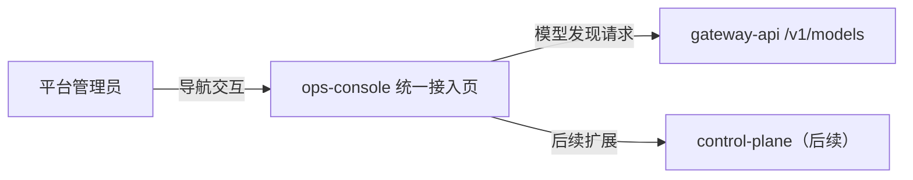
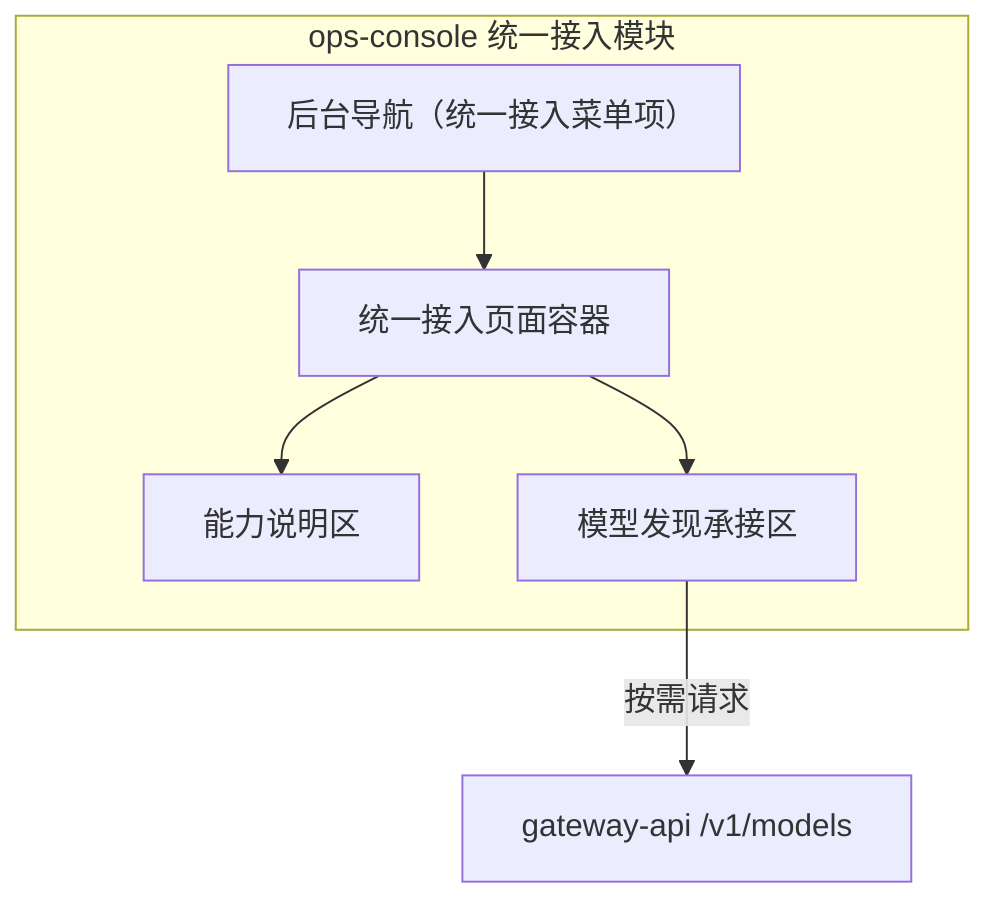
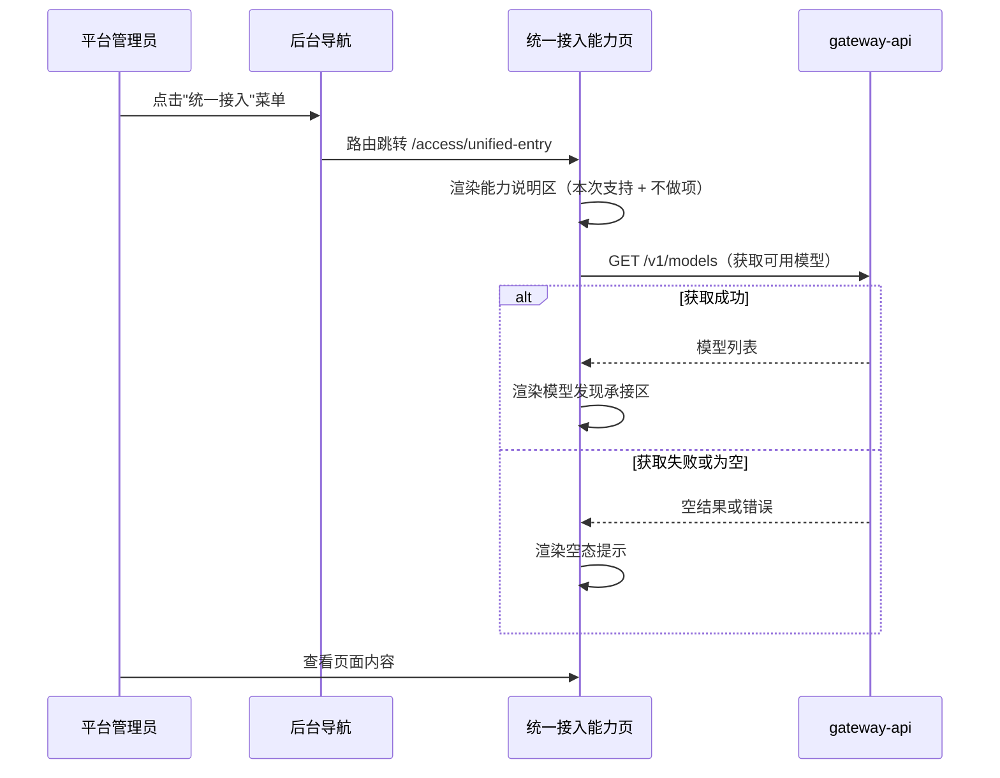
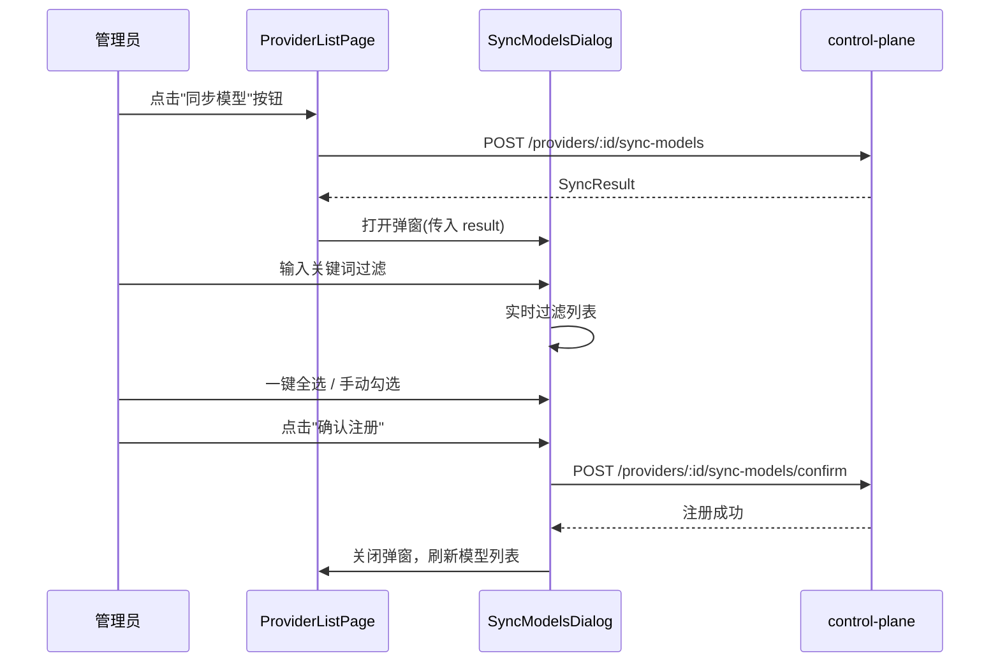
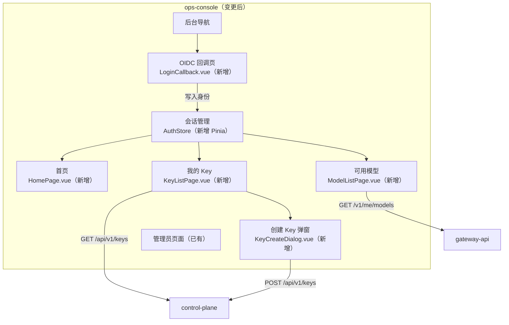
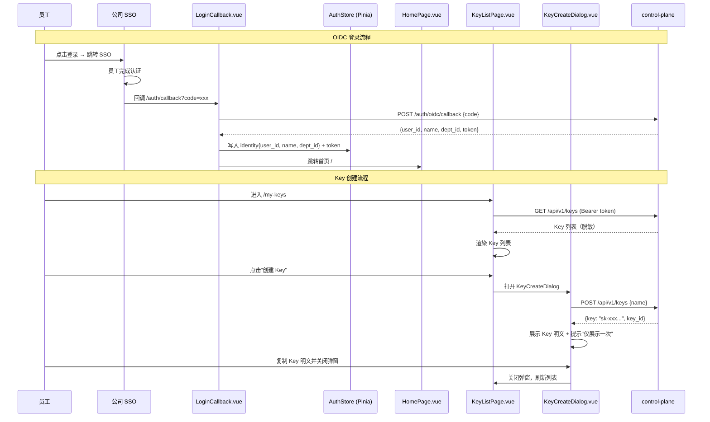
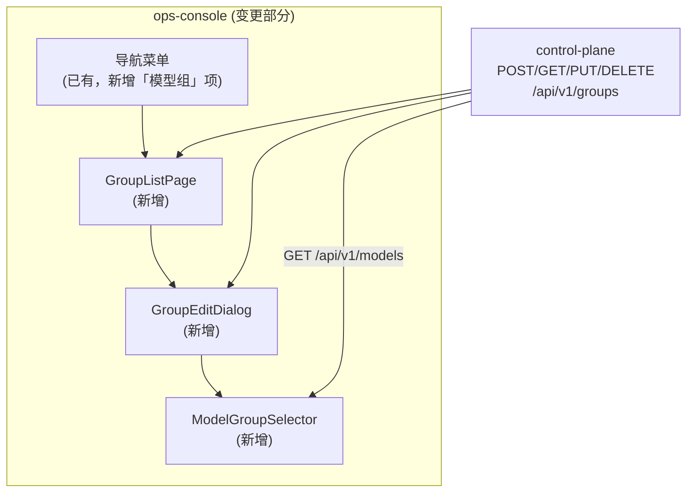
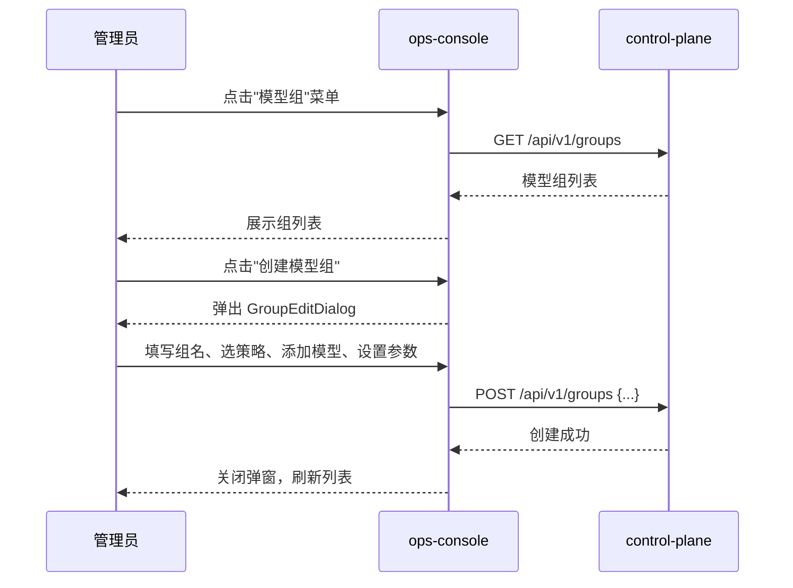

# ops-console Web 前端概要设计

## 0. 文档信息

| 属性 | 内容 |
| :--- | :--- |
| **所属变更** | CHG-20260521-001 |
| **模块名称** | ops-console |
| **模块类型** | web-frontend |
| **创建时间** | 2026-05-21 |

### 修订记录

| 版本号 | 修改日期 | 修改内容摘要 | 修改人 |
| :--- | :--- | :--- | :--- |
| v1.0 | 2026-05-21 | 初稿创建 | OpenCode |
| v1.1 | 2026-05-23 | 新增 SyncModelsDialog 组件与同步模型交互流程（CHG-20260521-002） | OpenCode |
| v1.2 | 2026-05-25 | 新增员工 SSO 登录、Key 管理、模型列表、首页文档页面架构 — CHG-20260523-001 | OpenCode |
| v1.3 | 2026-05-26 | 新增 GroupListPage / GroupEditDialog / ModelGroupSelector — CHG-20260525-001 | OpenCode |

---

## 1. 技术范围界定

### 1.1 起点与终点

| 维度 | 说明 |
| :--- | :--- |
| **起点** | 平台管理员进入后台并看到导航菜单 |
| **终点** | 管理员进入统一接入能力页，看到本次支持能力、明确不做项和模型发现承接区 |
| **解决的问题** | 为统一接入主链路提供后台入口和可演示页面承接，同时严格不扩展为完整治理后台 |

### 1.2 技术边界



- **上游**：后台导航体系、管理员浏览器访问上下文
- **下游**：gateway-api 的 /v1/models 接口（展示可用模型发现）；后续 control-plane 提供更多治理数据
- **不涉及**：完整后台信息架构重构、权限限额配置页、日志分析看板、普通员工自服务扩展

---

## 2. 架构方向探索

| 方向 | 核心思路 | 适合场景 | 风险 |
| :--- | :--- | :--- | :--- |
| 菜单承接式页面架构 | 在现有后台结构中新增统一接入菜单和单主题页面 | 本次仅做入口承接和能力说明 | 无明显风险 |

**选定方向**：菜单承接式页面架构
**选择理由**：本次只需要为统一接入提供一个菜单入口和说明页，不需要拆复杂前端子域或引入新的架构范式

---

## 3. 架构方案

### 3.1 页面结构



### 3.2 核心交互流程



### 3.2b 同步模型交互流程



**新增组件**：

| 组件 | 位置 | 职责 |
| :--- | :--- | :--- |
| SyncModelsDialog.vue | components/admin/ | 同步结果弹窗：展示列表、过滤、勾选、确认注册 |

### 3.3 路由规划

| 路由 | 页面 | 说明 |
| :--- | :--- | :--- |
| /access/unified-entry | 统一接入能力页 | 承接统一接入菜单入口与能力说明 |

---

## 4. 技术选型与约束

| 领域 | 选型 | 理由 |
| :--- | :--- | :--- |
| 框架 | Vue 3 + TypeScript | 项目技术栈已确定 |
| 状态管理 | Pinia | 项目已选定，本次页面状态简单 |
| 样式方案 | Element Plus 组件 + 项目现有样式体系 | 项目已选定，保持后台视觉一致 |
| 构建工具 | Vite | 项目已选定 |
| UI 组件库 | Element Plus | 项目已选定，管理后台标准组件库 |

### 宪章合规性

- [x] 符合 `constitution.md` 渐进演进原则：本次只做菜单入口和说明页，不提前铺满后台功能
- [x] 符合核心聚焦原则：不涉及 Prompt/Agent/工作流等范围外能力
- [x] 符合可验证交付原则：菜单可见、页面可进入、说明可阅读即为本次验收基线

---

## 5. 认证与会话

| 项 | 方案 |
| :--- | :--- |
| 认证方式 | 复用后台已有认证体系（SSO + JWT Cookie） |
| 登录页 | 后台统一登录流程，本次不新增 |
| 会话管理 | 复用后台已有 JWT Cookie 机制 |
| 登出 | 复用后台统一登出 |
| Token 刷新 | 复用后台已有刷新机制 |

---

## 6. 安全设计

| 威胁 | 防御措施 |
| :--- | :--- |
| XSS | 使用 Vue 3 默认模板转义，不使用 v-html 渲染用户输入 |
| CSRF | 复用后台已有 SameSite Cookie 防护 |
| 敏感数据存储 | 本次页面不涉及敏感数据输入或持久化 |

---

## 7. 观测与运维

### 7.1 质量目标

| 指标 | 目标值 | 测试条件 |
| :--- | :---: | :--- |
| FCP（首次内容绘制） | ≤ 2000 ms | 桌面端标准网络 |
| LCP（最大内容绘制） | ≤ 3000 ms | 桌面端标准网络 |
| CLS（累积布局偏移） | ≤ 0.1 | 正常加载 |
| 可用性 | ≥ 99.5% | 试点阶段滚动 7 天 |

### 7.2 监控指标

| 指标 | 说明 |
| :--- | :--- |
| JS 错误率 | 运行时异常上报 |
| 模型列表请求成功率 | /v1/models 调用成功 / 总请求 |
| 页面加载时间分位 | P50 / P90 |

### 7.3 错误追踪

| 维度 | 方案 |
| :--- | :--- |
| 错误上报 | 复用后台已有前端错误上报机制 |
| 日志脱敏 | 不在日志中输出用户身份详细信息 |
| Source Map | 仅上传到错误追踪平台，不暴露到生产 |

---

## 8. 失败模式与降级策略

| 失败场景 | 影响 | 降级策略 | 恢复方式 |
| :--- | :--- | :--- | :--- |
| /v1/models 接口不可用 | 模型发现区无数据 | 保留能力说明区可用，模型发现区展示空态提示 | 接口恢复后刷新页面即可 |
| 页面静态资源加载失败 | 页面不可见 | 复用后台统一 CDN 降级策略 | 资源恢复后刷新 |
| 会话过期 | 页面操作被拒 | 重定向到后台登录页 | 重新登录 |
| 网络断开 | 请求失败 | 显示网络异常提示，不丢失已展示内容 | 网络恢复后刷新 |

---

## 9. 待研究事项

不适用

> 本次前端技术栈（Vue 3 + Element Plus + Vite + Pinia）在项目中已有明确选型，页面复杂度低，无需额外技术研究。

---

## 10. 风险与对策

| 风险 | 概率 | 影响 | 对策 |
| :--- | :--- | :--- | :--- |
| 后台导航体系尚未搭建完成 | 中 | 中 | 本次可先用独立路由入口承接，后续补挂到正式导航 |
| 模型发现区数据源不稳定 | 低 | 低 | 做好空态处理，确保页面主体可用 |

---

## 11. 概要设计确认

- [x] 技术范围已界定
- [x] 架构方向已探索并选定
- [x] 架构方案已确认
- [x] 技术选型符合宪章
- [x] 待研究事项已识别（无需研究）

👉 确认后进入详细设计阶段（`/xf/detail`）


---

## 12. 变更记录 — CHG-20260523-001

## 变更摘要

新增 OIDC 登录回调页与员工会话管理、Key 自助管理页面（KeyListPage.vue + KeyCreateDialog.vue）、模型可用列表页面（基于 /v1/me/models）、首页欢迎与使用文档页；从纯管理后台扩展为员工 + 管理员双角色入口。

## 架构变更



### OIDC 登录 + Key 管理流程



## 技术选型变更

无变更，沿用 Vue 3 + Element Plus + Vite + Pinia 技术栈。

## 新增组件

| 组件 | 位置 | 职责 |
| :--- | :--- | :--- |
| LoginCallback.vue | views/auth/ | OIDC 回调页：接收 SSO code → 调 control-plane 换取身份 → 写入 AuthStore → 跳转首页；失败时展示明确错误提示 |
| AuthStore | stores/auth.ts | Pinia 状态管理：存储 identity{user_id, name, dept_id} + JWT token；提供 isAuthenticated getter；登出时清空身份并跳转 SSO |
| HomePage.vue | views/home/ | 首页欢迎与使用文档：展示员工姓名 + 部门、curl/OpenAI SDK 调用示例、跳转至我的 Key 和可用模型的快捷入口 |
| KeyListPage.vue | views/key/ | 我的 Key 页面：展示当前用户 Key 脱敏列表（末尾 4 位 + 状态 + 时间）；提供创建、禁用、启用、删除操作入口 |
| KeyCreateDialog.vue | components/key/ | 创建 Key 弹窗：调 POST /api/v1/keys → 展示 Key 明文 + "仅展示一次"提示 → 复制引导 → 关闭后刷新列表 |
| ModelListPage.vue | views/model/ | 可用模型页面：调 GET /v1/me/models 展示当前身份可用模型（名称、类型、状态）；空态提示"当前身份暂无可用模型" |

## 新增路由

| 路由 | 页面 | 认证要求 | 说明 |
| :--- | :--- | :--- | :--- |
| /auth/callback | LoginCallback.vue | 无（回调处理） | OIDC 回调入口，处理 SSO 认证结果 |
| / | HomePage.vue | 需登录 | 首页欢迎 + 使用文档 |
| /my-keys | KeyListPage.vue | 需登录 | Key 自助管理 |
| /models | ModelListPage.vue | 需登录 | 可用模型列表 |

## 认证与会话变更

| 项 | 变更前 | 变更后 |
| :--- | :--- | :--- |
| 认证方式 | 复用后台 SSO + JWT Cookie | 新增 OIDC 回调处理页，员工登录通过 OIDC code → control-plane 换取 token |
| 登录页 | 复用后台统一登录 | 新增 LoginCallback.vue 处理 OIDC 回调，失败展示错误提示 |
| 会话管理 | 复用后台 JWT Cookie | 新增 AuthStore (Pinia) 管理员工 identity + token，路由守卫检查 isAuthenticated |
| Token 刷新 | 复用后台已有机制 | AuthStore 管理 token 生命周期，过期时重定向 SSO 登录 |

## 新增 API 消费

| API | 来源模块 | 用途 |
| :--- | :--- | :--- |
| POST /auth/oidc/callback | control-plane | OIDC 回调换取身份 token |
| GET /api/v1/keys | control-plane | 查询当前用户 Key 列表（脱敏） |
| POST /api/v1/keys | control-plane | 创建新 Key |
| PATCH /api/v1/keys/:id/status | control-plane | 禁用/启用 Key |
| DELETE /api/v1/keys/:id | control-plane | 删除 Key |
| GET /v1/me/models | gateway-api | 查询当前身份可用模型 |

## 安全设计补充

| 威胁 | 防御措施 |
| :--- | :--- |
| OIDC code 被截获 | code 仅一次性有效，回调后立即换取 token；code 使用后由 SSO 服务端标记为已消费 |
| Key 明文在弹窗中被截图 | 弹窗明确提示"仅展示一次"，关闭后不再展示；不使用 localStorage 缓存明文 |
| 跨角色操作（员工访问管理页面） | 路由守卫基于 AuthStore 中的角色字段做页面级权限隔离 |


## 13. 变更记录 — CHG-20260525-001

## 变更摘要

在现有管理后台导航中新增"模型组"菜单及三个核心组件：GroupListPage（组列表页）、GroupEditDialog（创建/编辑面板）、ModelGroupSelector（组内模型选择器）。新增组件消费 control-plane 的模型组 CRUD 接口。

## 架构变更



## 新增组件

| 组件 | 职责 | 路由 |
| :--- | :--- | :--- |
| 模型组菜单项 | 导航中新增"模型组"入口 | `/groups` |
| GroupListPage | 模型组列表展示、搜索、删除确认 | `/groups` |
| GroupEditDialog | 模型组创建/编辑表单（名称、描述、策略选择） | 弹窗形式 |
| ModelGroupSelector | 组内模型选择器：多选已注册模型、设置优先级/权重、移除 | 内嵌于 GroupEditDialog |

## 页面结构

```
/groups                           — 模型组列表页
  ├── 搜索框（按组名搜索）
  ├── 模型组列表（组名/策略/模型数/状态）
  │   ├── [编辑] → GroupEditDialog
  │   └── [删除] → 二次确认弹窗
  └── [创建模型组] → GroupEditDialog

GroupEditDialog                   — 创建/编辑弹窗
  ├── 基本信息区（组名/描述/策略选择）
  ├── 模型列表区
  │   ├── [已选模型 - 策略参数 - 移除]
  │   └── [添加模型] → ModelGroupSelector
  └── [保存] / [取消]

ModelGroupSelector                — 模型选择面板
  ├── 搜索过滤框
  ├── 全量模型列表（多选 + 已选禁用）
  └── [确认] / [取消]
```

## 交互流程



## 关键决策

| 决策 | 选择 | 理由 |
| :--- | :--- | :--- |
| 模型选择器来源 | 从 control-plane 全量模型列表中多选 | 跨组允许，同一模型可出现在多个组 |
| 策略切换提示 | 切换策略类型时弹提示"将清除策略参数" | 防止切换策略后残留不兼容参数 |
| 删除确认 | 二次确认弹窗 | 删除不可逆，防止误操作 |

## 技术选型

无新增技术选型。沿用现有 Vue 3 + Element Plus 前端技术栈，通过 HTTP 调用 control-plane 接口。