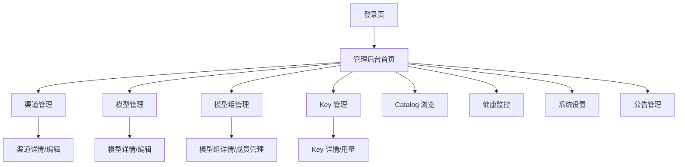

# ops-console 需求规范

## 0. 文档信息

| 属性 | 内容 |
| :--- | :--- |
| **所属变更** | baseline-v1.0 |
| **模块名称** | ops-console |
| **模块类型** | web-frontend |
| **创建时间** | 2026-06-03 |

### 修订记录

| 版本号 | 修改日期 | 修改内容摘要 | 修改人 |
| :--- | :--- | :--- | :--- |
| v1.0 | 2026-06-03 | 基线初稿，记录已实现的 v1.0 能力 | Sisyphus |

---

## 1. 需求背景与目标

管理后台是 LLM Gateway 的用户操作界面，为管理员和普通用户提供渠道配置、模型管理、Key 自助、用量查看等核心交互。目标是极致聚焦于"Key + 模型 + 日志 + 限额 + 权限"五大模块，告别 LiteLLM 的臃肿 UI。

- **业务背景**：管理员需要一个直观的界面来日常运维网关；员工需要一个自助入口管理自己的 Key 和查看用量
- **核心目标**：构建极致聚焦、交互流畅的管理控制台，核心操作不超过 3 步完成
- **成功指标**：
  - 管理员日常运维操作（建渠道/加模型/配模型组）平均 < 3 步
  - 用户自助创建 Key 流程 < 1 分钟
  - 页面首屏加载 < 1.5s

---

## 2. 关键概念

- **渠道 (Channel)**：厂商对接配置的可视化管理界面
- **模型 (Model)**：绑定到渠道的具体模型实例
- **模型组 (Group)**：对外暴露的模型名及成员管理
- **API Key**：用户的调用凭证，包含限额、设备绑定
- **Catalog**：从 LiteLLM 同步的模型元数据浏览
- **健康监控**：各渠道的连通性状态和实时指标
- **系统设置**：全局配置项管理

---

## 3. 超出范围

- 不包含移动端适配，仅桌面端（≥ 1280px 宽）
- 不包含终端用户的对话界面（非 ChatGPT 类 UI）
- 不包含 Prometheus/Grafana 类复杂仪表盘
- 不包含计费结算 UI

---

## 4. 目标用户与使用场景

- **目标用户**：系统管理员（运维）、部门管理员（部门管控）、普通员工（自助 Key 和用量查看）
- **核心场景**：管理员日常增删改查渠道/模型/模型组；员工自助创建 Key、查看用量

### 用户故事

| 编号 | 角色 | 行为 | 目的 | 优先级 |
| :--- | :--- | :--- | :--- | :--- |
| US-01 | 作为管理员 | 我想要创建渠道并配置厂商 API Key | 以便快速对接新的模型厂商 | P0 |
| US-02 | 作为管理员 | 我想要创建模型组并添加成员 | 以便对外暴露统一的模型名 | P0 |
| US-03 | 作为管理员 | 我想要查看各渠道的健康状态 | 以便及时发现故障厂商 | P0 |
| US-04 | 作为普通员工 | 我想要自助创建 API Key | 以便开始使用大模型 | P0 |
| US-05 | 作为普通员工 | 我想要查看自己的用量统计 | 以便了解使用情况 | P1 |
| US-06 | 作为部门管理员 | 我想要管理部门成员的 Key 和限额 | 以便控制部门成本 | P1 |

---

## 5. 页面流与路由结构

### 主要页面结构

### 路由定义

| 路由路径 | 页面名称 | 说明 |
| :--- | :--- | :--- |
| `/admin/channels` | 渠道管理 | 渠道列表、创建、编辑、删除、健康检查 |
| `/admin/models` | 模型管理 | 模型列表、创建、编辑、删除 |
| `/admin/groups` | 模型组管理 | 模型组列表、创建、编辑、成员管理 |
| `/admin/keys` | Key 管理 | Key 列表、创建、吊销、暂停、恢复 |
| `/admin/catalog` | Catalog 浏览 | 查看同步的模型元数据 |
| `/admin/health` | 健康监控 | 渠道连通性状态面板 |
| `/admin/settings` | 系统设置 | 全局配置 |
| `/admin/announcements` | 公告管理 | 系统公告 CRUD |

---

## 6. 详细功能说明

### 6.1 渠道管理（关联 US-01）

**A. 界面与交互说明**

- 表格展示所有渠道，列：名称、Provider 类型、状态（启用/禁用）、连通性、操作
- 创建/编辑弹窗表单：Provider 类型选择、API Key、Base URL、超时等参数
- 行内操作：启用/禁用切换、健康检查触发
- 删除需二次确认，关联模型时提示级联影响

**B. 核心展示与业务逻辑**

- Provider 类型从后端枚举获取，下拉选择
- 健康检查结果实时展示（绿色勾 / 红色叉 + 延迟数字）
- 状态变更即时生效

**C. 异常与边界状态**

- **网络异常**：表单提交失败时展示具体错误信息，保留已填写内容
- **空状态**：无渠道时展示引导插画和"创建第一个渠道"按钮
- **健康检查超时**：展示黄色警告 + 超时提示

### 6.2 模型管理

**A. 界面与交互说明**

- 表格展示所有模型，列：模型名、关联渠道、Catalog 名称、权重、状态
- 创建表单：选择渠道 → 选择 Catalog 条目（可选）→ 设置权重
- 关联 Catalog 后自动填充能力/价格/上下文信息

### 6.3 模型组管理（关联 US-02）

**A. 界面与交互说明**

- 表格展示所有模型组，列：组名、成员数量、能力摘要、状态
- 模型组详情页：成员列表 + 添加/移除成员 + 权重调整
- 能力聚合信息展示（保守语义：全部成员支持的能力）

**B. 核心展示与业务逻辑**

- 添加成员时可搜索模型名 + 渠道筛选
- 成员权重可视化调整（滑块或数字输入）

### 6.4 Key 管理（关联 US-04、US-05、US-06）

**A. 界面与交互说明**

- 管理员视角：全量 Key 列表，含搜索/筛选（按用户、部门、状态）
- 普通用户视角：仅展示自己的 Key，含创建、查看、用量统计
- Key 信息展示：部分隐藏的 Key 值（点击显示）、绑定的模型组、限额、设备列表
- 操作：创建 Key、吊销、暂停/恢复、查看用量

**B. 核心展示与业务逻辑**

- 创建 Key 流程：选择模型组（可多选）→ 设置限额 → 确认创建 → 展示 Key（仅展示一次）
- 用量统计：图表展示 Token 消耗趋势、分模型组占比

**C. 异常与边界状态**

- **Key 仅展示一次**：创建成功后 Key 全量展示，关闭后无法再次查看，需引导用户立即复制保存
- **限额接近**：黄色预警，限额耗尽时红色告警 + 请求被拒绝

### 6.5 健康监控（关联 US-03）

**A. 界面与交互说明**

- Dashboard 风格面板，展示各渠道连通性状态
- 实时/准实时延迟指标（平均延迟、P95）
- 异常渠道高亮标红，点击查看详情

### 6.6 系统设置

**A. 界面与交互说明**

- 全局配置项表单：Catalog 同步地址、默认超时、内部 Token 管理
- 设置变更即时生效，部分需确认后刷新

---

## 7. 状态管理需求

| 状态名称 | 类型 | 说明 |
| :--- | :--- | :--- |
| channels | Array\<Channel\> | 渠道列表 |
| models | Array\<Model\> | 模型列表 |
| groups | Array\<Group\> | 模型组列表 |
| keys | Array\<Key\> | Key 列表 |
| currentUser | User | 当前登录用户 |
| authToken | string | JWT Token |

---

## 8. 非功能需求

- **浏览器兼容性**：Chrome 90+、Edge 90+、Safari 15+
- **性能要求**：首屏加载 < 1.5s，表格翻页响应 < 200ms
- **响应式设计**：桌面端 ≥ 1280px 宽，不支持移动端
- **无障碍**：表单控件支持键盘操作，错误信息有 aria 标注

---

## 9. 验收标准

| 编号 | 关联 | Given（前置状态） | When（触发动作） | Then（预期结果） | 优先级 |
| :--- | :--- | :--- | :--- | :--- | :--- |
| AC-01 | US-01 | Given 管理员在渠道管理页 | When 点击"创建渠道"并填写表单提交 | Then 渠道创建成功，列表自动刷新 | P0 |
| AC-02 | US-02 | Given 管理员在模型组详情页 | When 添加新成员并保存 | Then 成员添加成功，能力聚合信息自动更新 | P0 |
| AC-03 | US-04 | Given 普通员工在 Key 管理页 | When 点击"创建 Key"并选择模型组后确认 | Then Key 创建成功，全量展示 Key 值 | P0 |
| AC-04 | US-04 | Given 员工关闭 Key 展示弹窗 | When 再次查看该 Key | Then Key 值部分隐藏，无法再看到完整 Key | P1 |
| AC-05 | US-03 | Given 管理员在健康监控页 | When 某渠道故障 | Then 该渠道标红，延迟数据异常 | P1 |
| AC-06 | US-05 | Given 员工在 Key 用量页 | When 查看用量统计 | Then 展示 Token 消耗趋势图和分模型组占比 | P1 |

---

## 10. 假设与依赖

- 假设后端 API 已按 contracts 约定提供所有 CRUD 接口
- 依赖 control-plane 模块稳定运行
- 依赖 Element Plus 组件库版本稳定
- 假设用户浏览器支持 ES2020+