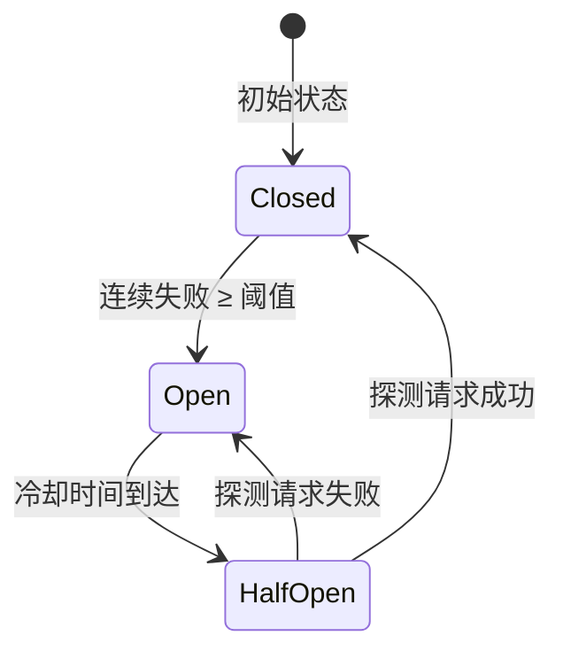

# provider-adapters 需求规范

## 0. 文档信息

| 属性 | 内容 |
| :--- | :--- |
| **所属变更** | baseline-v1.0 |
| **模块名称** | provider-adapters |
| **模块类型** | web-backend |
| **创建时间** | 2026-06-03 |

### 修订记录

| 版本号 | 修改日期 | 修改内容摘要 | 修改人 |
| :--- | :--- | :--- | :--- |
| v1.0 | 2026-06-03 | 基线初稿，记录已实现的 v1.0 能力 | Sisyphus |

---

## 1. 业务背景与系统目标

将 17+ 家厂商的异构 API 统一为 `core.Provider` 接口抽象，使网关核心无需感知厂商差异。每个厂商 adapter 负责：请求格式转换、响应解析、流式处理适配、重试/熔断逻辑。

- **业务背景**：公司使用多家大模型厂商（OpenAI、百炼、DeepSeek、AWS Bedrock 等），每家 API 协议不同。需要统一的适配层屏蔽差异
- **核心目标**：提供标准化的 Provider 接口实现，支持快速新增厂商，统一错误处理、重试、熔断
- **关键衡量指标**：
  - 支持 17+ 厂商
  - 新增厂商 adapter 开发成本 < 2 天
  - 适配层本身引入延迟 < 5ms

---

## 2. 关键概念

- **Provider**：厂商适配器的标准接口（`core.Provider`），定义 `ChatCompletion`、`ChatCompletionStream`、`Embeddings` 等方法
- **Router**：`providers.Router`，按模型名 match 到具体 Provider 实例的路由表。每个 Provider 注册时声明自己能处理的 model 白名单
- **Factory**：`providers.Factory`，根据配置创建 Provider 实例的工厂函数。在 `cmd/gateway/main.go` 的 `buildProviderFactory()` 中注册
- **Registry**：模型注册表，维护 model ID → Provider 的映射关系
- **Circuit Breaker**：熔断器，当某 Provider 连续失败达到阈值时自动熔断，避免雪崩（`internal/llmclient/circuit_breaker.go`）
- **Fallback**：候选链回退机制，当首选 Provider 不可用时，按配置的 fallback 链尝试备选

---

## 3. 超出范围

- 不负责请求的鉴权和 Key 验证（由 gateway-core 负责）
- 不负责模型组的调度决策（由 gateway-core 的 Scheduler 负责）
- 不负责 HTTP 服务器的启动和路由注册（由 gateway-core 负责）
- 不负责配置管理（配置由 control-plane 下发，gateway-core 的 ProviderLoader 加载）
- 不负责流式响应的最终下发（scheduler 选择 Provider 后，由 gateway-core handler 负责 SSE 转发）

---

## 4. 角色与权限控制 (RBAC)

此模块为 library 层，由 gateway-core 在进程内调用，无独立的 RBAC 需求。

---

## 5. 核心对象状态机

### Circuit Breaker 状态

| 当前状态 | 触发动作 | 目标状态 | 前置条件 |
| :--- | :--- | :--- | :--- |
| Closed | 连续 N 次失败 | Open | 失败计数 ≥ 阈值 |
| Open | 冷却时间到达 | HalfOpen | 距上次打开 ≥ timeout |
| HalfOpen | 探测请求成功 | Closed | 重置失败计数 |
| HalfOpen | 探测请求失败 | Open | 重新进入冷却 |

---

## 6. 详细功能需求

### 6.1 Provider 接口抽象

**A. 功能说明**

定义统一的 `core.Provider` 接口，所有厂商 adapter 必须实现。包括同步聊天补全、流式聊天补全、Embeddings 三个核心能力。

**C. 接口概要**

| 接口 | 方法 | 说明 |
| :--- | :--- | :--- |
| ChatCompletion | `ChatCompletion(ctx, req) -> ChatResponse, error` | 同步聊天补全 |
| ChatCompletionStream | `ChatCompletionStream(ctx, req) -> <-chan StreamChunk, error` | 流式聊天补全，返回 channel |
| Embeddings | `Embeddings(ctx, req) -> EmbeddingResponse, error` | 文本嵌入 |
| ProviderInfo | `ProviderInfo() -> ProviderInfo` | 返回 Provider 元信息（名称、支持模型等）|

**D. 业务规则与校验**

- 所有 adapter 必须实现 `core.Provider` 接口的全部方法
- 流式接口返回 `<-chan StreamChunk`，由调用方消费 channel，支持 context 取消
- `StreamChunk` 包含标准化的事件类型（`EventType`）：`EventTypeChunk`（内容块）、`EventTypeDone`（结束）、`EventTypeError`（错误）

### 6.2 多厂商 Adapter

**A. 功能说明**

为每家厂商实现独立的 adapter，负责将标准化的请求参数转换为厂商特定的 API 格式，并将厂商响应解析为标准化格式。

**已支持厂商列表：**

| 厂商 | Adapter 路径 | 说明 |
| :--- | :--- | :--- |
| OpenAI | `internal/providers/openai/` | OpenAI 及其兼容 API |
| 百炼 (DashScope) | `internal/providers/dashscope/` | 阿里云百炼平台 |
| DeepSeek | `internal/providers/deepseek/` | DeepSeek API |
| Anthropic (Claude) | `internal/providers/anthropic/` | Anthropic Claude 系列 |
| Google (Gemini) | `internal/providers/google/` | Google Gemini 系列 |
| AWS Bedrock | `internal/providers/bedrock/` | AWS Bedrock 托管模型 |
| Azure OpenAI | `internal/providers/azure/` | Azure OpenAI Service |
| 其他厂商 | `internal/providers/<vendor>/` | 其他已适配厂商 |

**D. 业务规则与校验**

- 每个 adapter 必须在 `buildProviderFactory()` 中注册 Type 和 Factory
- 请求参数转换不得丢失关键字段（messages、temperature、max_tokens 等）
- 错误响应需标准化为 `core.Error` 类型，包含 HTTP 状态码 + 错误码 + 描述
- 流式响应必须正确处理厂商特定的 SSE 结束标记（如 `[DONE]`）

### 6.3 Router 与 Registry

**A. 功能说明**

维护模型注册表和路由表。Provider 注册时声明自己能处理的 model 列表，Router 根据请求的 model 名匹配到具体 Provider。

**D. 业务规则与校验**

- Router 支持精确匹配和通配符匹配
- 多个 Provider 可注册同一 model（通过优先级区分）
- Router 原子替换：配置变更时整体替换，不部分更新
- 未匹配到 model 时返回明确错误，列出已知模型列表

### 6.4 容错与重试

**A. 功能说明**

提供 HTTP 客户端层的重试和熔断能力，防止上游厂商故障导致网关雪崩。

**D. 业务规则与校验**

- 重试策略：指数退避，最多 3 次
- 熔断阈值：连续失败 N 次后打开熔断器
- 熔断冷却时间：可配置（默认 30s）
- 半开状态：允许 1 个探测请求，成功则关闭熔断器
- 熔断器按 Provider 实例独立计数，不影响其他 Provider

**E. 异常与边界**

- **全部 Provider 熔断**：返回 503，不无限等待
- **重试耗尽**：返回最后一次请求的错误
- **超时**：context 超时被正常传递，不会阻塞重试

### 6.5 Fallback 候选链

**A. 功能说明**

支持配置 Provider 的 fallback 候选链。当首选 Provider 不可用（熔断、超时、错误）时，按配置的回退链尝试备选。

---

## 7. 数据流与外部接口

- **上游 HTTP 调用**：通过 `internal/httpclient/` 和 `internal/llmclient/` 发起到厂商 API
- **无外部依赖**：此模块为纯函数/纯接口层，不依赖 Redis、Postgres 或其他外部服务
- **配置注入**：Provider 配置（API Key、Endpoint 等）由 gateway-core 的 ProviderLoader 注入

---

## 8. 非功能需求

- **性能**：adapter 请求转换开销 < 1ms，不引入显著额外延迟
- **可靠性**：熔断器防止雪崩，fallback 链提供降级路径
- **可扩展性**：新增厂商只需实现 `core.Provider` + 注册 Type，不应修改核心抽象
- **安全性**：API Key 不在日志中打印，不在栈追踪中泄露

---

## 9. 验收标准

| 编号 | 关联 | Given（前置状态） | When（触发动作） | Then（预期结果） | 优先级 |
| :--- | :--- | :--- | :--- | :--- | :--- |
| AC-01 | 接口 | Given 某厂商 adapter 已注册 | When 调用 ChatCompletion | Then 请求正确转换为厂商格式，响应正确解析为标准化格式 | P0 |
| AC-02 | 流式 | Given 厂商支持 SSE 流式 | When 调用 ChatCompletionStream | Then 返回 channel 逐 chunk 输出，正确解析 SSE 格式 | P0 |
| AC-03 | 路由 | Given Router 中注册了 model "gpt-4" | When 按 "gpt-4" 查找 Provider | Then 返回正确的 Provider 实例 | P0 |
| AC-04 | 熔断 | Given Provider 连续失败 5 次 | When 第 6 次请求 | Then 熔断器打开，请求直接失败不等待超时 | P1 |
| AC-05 | 熔断恢复 | Given 熔断器打开且冷却时间已到 | When 探测请求成功 | Then 熔断器关闭，恢复正常服务 | P1 |
| AC-06 | Fallback | Given 首选 Provider 熔断，fallback 可用 | When 发起请求 | Then 自动切换到 fallback Provider | P1 |
| AC-07 | 新增厂商 | Given 新厂商 adapter 实现 core.Provider | When 注册到 Factory | Then Router 能正确路由到新厂商，core.Provider 接口无需修改 | P1 |

---

## 10. 假设与依赖

- 假设上游厂商 API 基本稳定，breaking change 概率低
- 依赖 `internal/httpclient/` 和 `internal/llmclient/` 提供可靠的 HTTP 传输层
- 依赖 gateway-core 正确注入 Provider 配置