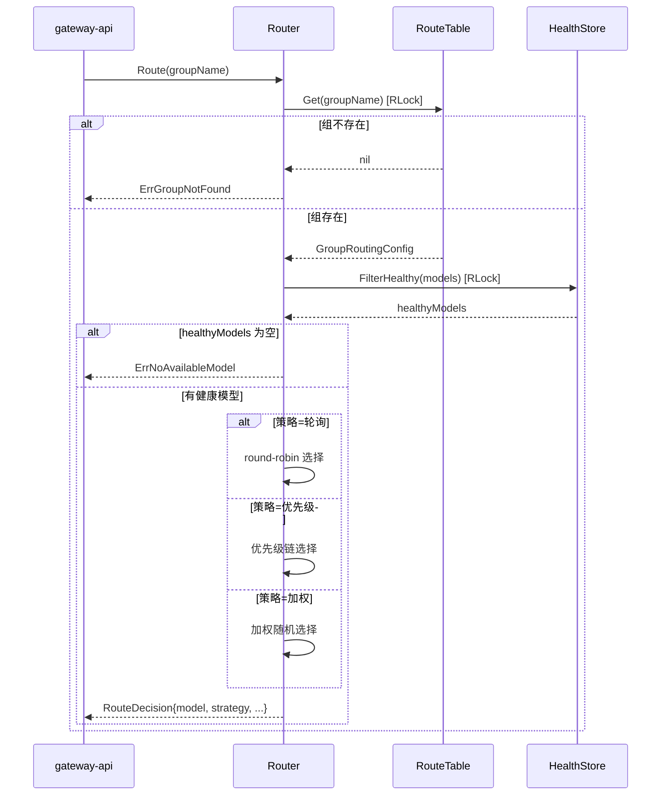
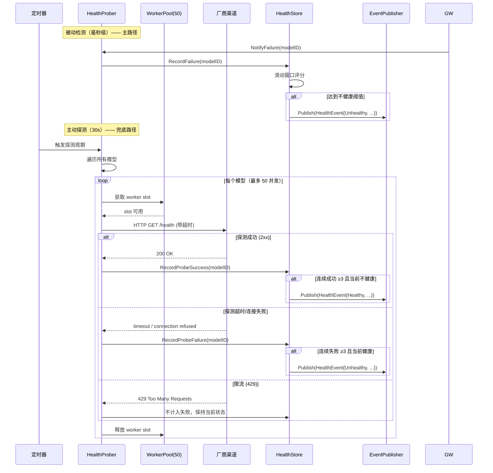
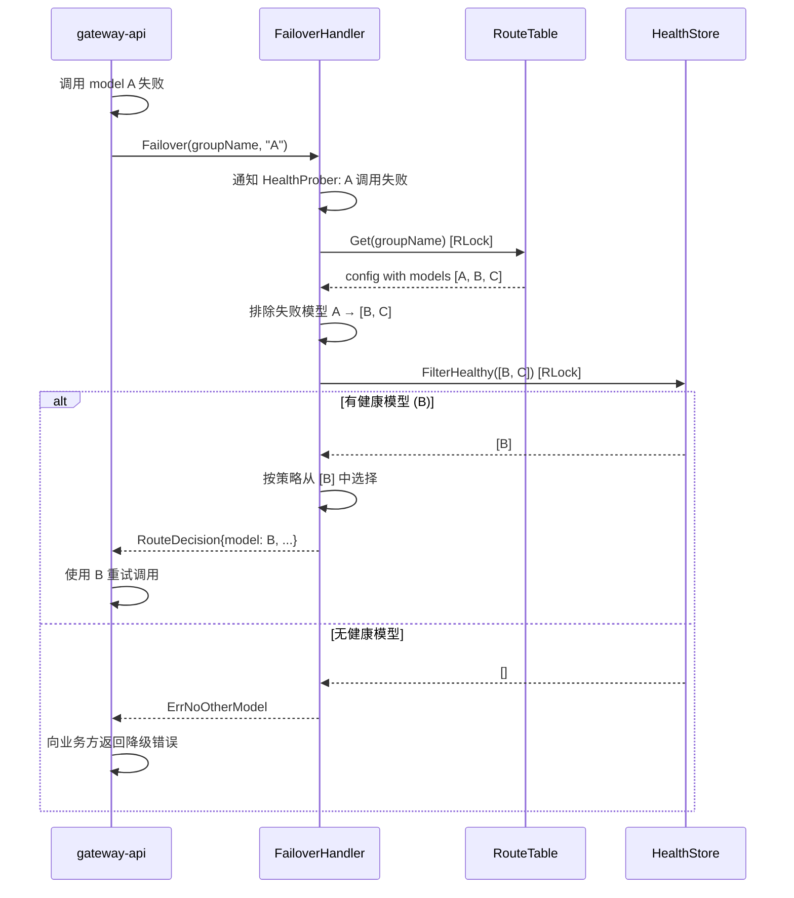
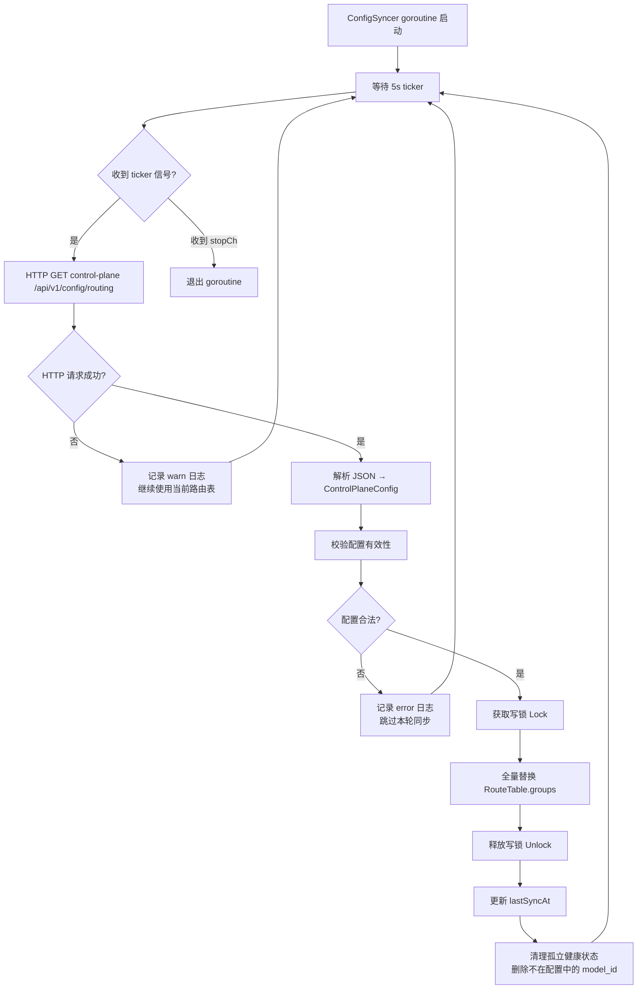
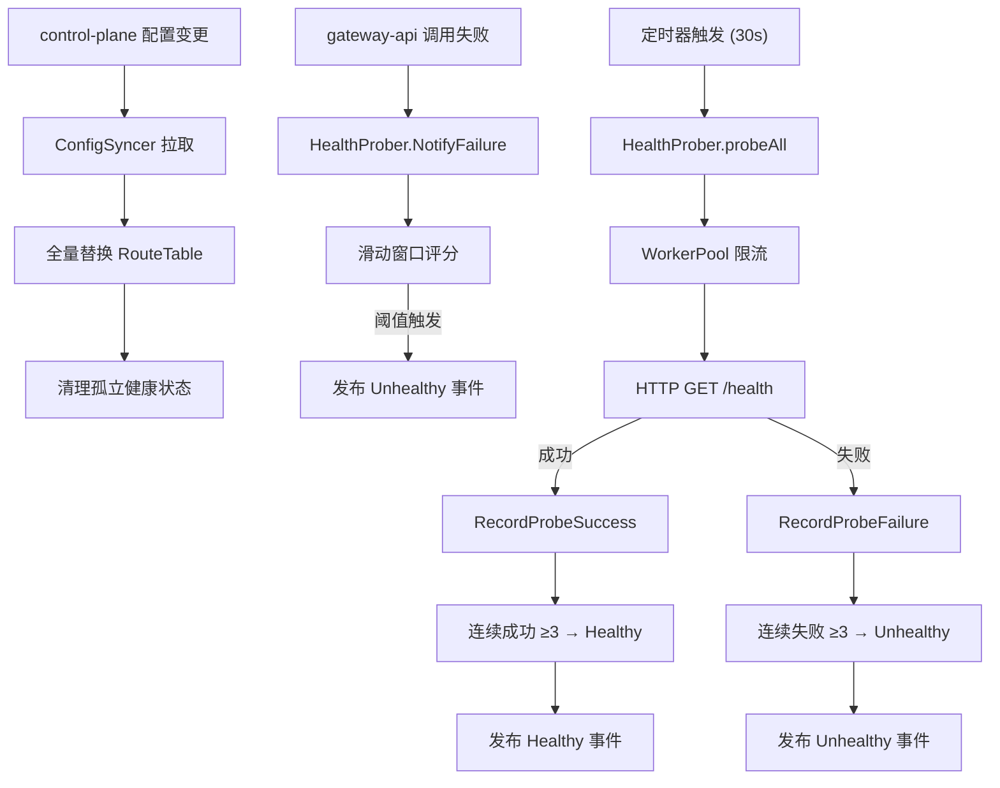

# scheduler Web 后端详细设计

## 0. 文档信息

| 属性 | 内容 |
| :--- | :--- |
| **所属变更** | CHG-20260525-001 |
| **模块名称** | scheduler |
| **模块类型** | web-backend |
| **创建时间** | 2026-05-25 |

### 修订记录

| 版本号 | 修改日期 | 修改内容摘要 | 修改人 |
| :--- | :--- | :--- | :--- |
| v1.0 | 2026-05-25 | 初稿创建 | OpenCode |

---

## 1. 背景与目标

* **技术背景**：gateway-api 调用 LLM 时需要选择一个具体的厂商渠道模型，当前缺乏进程内的模型组路由决策、负载均衡、健康探测和故障切换能力，所有厂商渠道选择逻辑需由网关层自行处理，导致路由策略与健康管理耦合在业务代码中。
* **技术目标**：为 gateway-api 提供进程内模型组路由决策、负载均衡、健康探测和故障切换能力，通过嵌入式 package 实现零网络延迟的调度决策，支持轮询/优先级/加权三种路由策略，并以被动检测 + 主动探测双机制保障模型可用性。

---

## 2. 模块职责边界

**负责：**

- 模型组路由策略执行（轮询 / 优先级 / 加权）
- 模型健康状态管理与实时评分
- 厂商渠道被动故障检测与主动健康探测
- 故障自动切换（同组内选择备选模型）
- 从 control-plane 同步全量路由配置
- 健康状态变更事件发布

**不负责（显式排除）：**

- 用户认证鉴权（→ gateway-api）
- 模型调用的实际 HTTP 代理转发（→ gateway-api）
- 调用日志收集与上报（→ observability-hub）
- 路由配置的增删改管理与持久化（→ control-plane）
- 数据库持久化（scheduler 仅使用内存存储）

**调用关系：**

| 方向 | 模块 | 方式 |
| :--- | :--- | :--- |
| 被调用 | gateway-api | Go 函数调用（同进程内） |
| 调用（读） | control-plane | HTTP GET 定时拉取配置 |
| 调用（写） | 各厂商渠道 | HTTP GET /health 健康探测 |

---

## 3. 技术选型与研究

### 3.1 关键技术问题

| 问题 | 选择方案 | 备选方案 | 选择理由 |
| :--- | :--- | :--- | :--- |
| 存储方式 | Go 内存结构（map + sync.RWMutex） | Redis / etcd 外部缓存 | 调度决策需极低延迟，内存读取避免网络 IO；配置来源于 control-plane 可随时重建，无需持久化 |
| 配置同步 | HTTP 全量拉取（5s 间隔） | WebSocket 推送 / gRPC 流 | HTTP 实现简单，5s 最终一致对路由决策足够；全量替换避免增量同步的一致性 bug |
| 健康探测 | HTTP GET /health + 被动回调 | gRPC Health Check / TCP 端口探测 | 厂商渠道统一暴露 HTTP 端点，与业务协议一致；被动检测覆盖实时调用失败，毫秒级感知 |
| 并发模型 | sync.RWMutex + atomic.Int64 | channel-based actor | 路由决策为高频读、低频写场景，RWMutex 允许多 goroutine 并发读，性能最优 |
| 数据库依赖 | 无外部数据库 | PostgreSQL / SQLite | 路由表数据全部由 control-plane 下发，本地无需存储历史；无 DB 降低运维复杂度 |

### 3.2 技术研究总结

scheduler 作为 gateway-api 的嵌入式 Go package，所有数据存储在进程内存中，不依赖任何外部数据库。配置数据通过 HTTP 从 control-plane 定时拉取，健康状态通过主动 HTTP 探测和被动失败回调双机制维护。路由决策基于内存数据实时计算，目标延迟低于 10ms。

---

## 4. 架构概述

scheduler 作为 Go package 嵌入 gateway-api 进程内运行，不独立部署。gateway-api 通过函数调用使用 scheduler 的路由和切换能力。scheduler 内部通过 HTTP 客户端访问 control-plane（配置同步）和各厂商渠道（健康探测）。

### 4.1 组件总览

```
scheduler package
├── RouteTable      内存路由表 (sync.RWMutex)
├── HealthStore     模型健康状态存储 (atomic map)
├── Router          路由决策引擎
├── FailoverHandler 故障切换处理器
├── ConfigSyncer    配置同步器（后台 goroutine）
├── HealthProber    健康探测引擎（后台 goroutine pool）
└── EventPublisher  事件发布器
```

---

### 4.2 RouteTable — 内存路由表

存储组→策略→模型的完整映射关系，是路由决策的唯一数据源。

**Go 结构体定义**：

```go
type RouteTable struct {
    mu     sync.RWMutex
    groups map[string]*GroupRoutingConfig // key: group_name
}

type GroupRoutingConfig struct {
    GroupName  string
    Strategy   RoutingStrategy    // 路由策略枚举
    Models     []*ModelRoutingEntry // 组内模型列表
    RoundRobin atomic.Int64       // 轮询计数器（仅轮询策略使用）
    UpdatedAt  time.Time          // 最后更新时间
}

type ModelRoutingEntry struct {
    ModelID   string           // 模型唯一标识
    ModelName string           // 模型名称
    GroupID   string           // 所属组 ID
    Priority  int              // 优先级（仅优先级策略使用，1 最高）
    Weight    int              // 权重（仅加权策略使用，1-100）
    ChannelInfo ChannelEndpoint // 渠道连接信息
}

type ChannelEndpoint struct {
    ChannelID  string // 渠道 ID
    Endpoint   string // 渠道端点 URL
    Credential string // 认证凭证
    TimeoutMs  int    // 探测超时（毫秒）
}
```

**并发模型**：
- 读路径（路由决策）：持有 RLock，多 goroutine 并发读
- 写路径（配置同步）：持有 Lock，全量替换组配置
- 轮询计数器：使用 `atomic.Int64` 无锁递增，避免写锁竞争

---

### 4.3 HealthStore — 健康状态存储

存储每个模型的实时健康状态、连续成功/失败计数和滑动窗口记录。

**Go 结构体定义**：

```go
type HealthStore struct {
    mu     sync.RWMutex
    states map[string]*ModelHealthStatus // key: model_id
}

type ModelHealthStatus struct {
    ModelID             string        // 模型唯一标识
    Status              HealthStatus   // 当前状态：Healthy / Unhealthy
    ConsecutiveFailures int           // 连续失败次数
    ConsecutiveSuccesses int           // 连续成功次数
    FailureWindow        *FailureRingBuffer // 5s 滑动窗口失败记录
    QuickFailCount       int           // 60s 内快速失败次数
    QuickFailWindowStart time.Time    // 快速失败窗口起始时间
    LastProbeTime        time.Time     // 最后一次主动探测时间
    LastFailTime         time.Time     // 最后一次失败时间（含被动和主动）
    LastStateChange      time.Time     // 最后状态变更时间
    CreatedAt            time.Time     // 首次注册时间
}

// FailureRingBuffer 5s 滑动窗口环形缓冲
type FailureRingBuffer struct {
    timestamps []time.Time // 固定容量环形数组
    head       int         // 写入位置
    size       int         // 当前有效元素数
    cap        int         // 容量
}
```

**评分逻辑**：

```
// 被动检测：调用失败通知到达时
OnCallFailure(modelID):
    health := store.Get(modelID)
    health.FailureWindow.Record(now)
    health.ConsecutiveFailures++
    health.ConsecutiveSuccesses = 0
    health.LastFailTime = now

    if health.FailureWindow.RecentFailures(5s) >= 3:
        health.markUnhealthy()     // 标记不健康 + 发布事件
    end

    if now - health.QuickFailWindowStart > 60s:
        health.QuickFailCount = 0
        health.QuickFailWindowStart = now

    health.QuickFailCount++
    if health.QuickFailCount >= 5:
        health.markUnhealthy()     // 快速失败触发
    end

// 主动探测：定时器触发
OnProbeResult(modelID, success):
    health := store.Get(modelID)
    if success:
        health.ConsecutiveSuccesses++
        health.ConsecutiveFailures = 0
        if health.ConsecutiveSuccesses >= 3:
            health.markHealthy()   // 标记健康 + 发布事件
    else:
        health.FailureWindow.Record(now)
        health.ConsecutiveFailures++
        health.ConsecutiveSuccesses = 0
        health.LastFailTime = now
        if health.ConsecutiveFailures >= 3:
            health.markUnhealthy()
    health.LastProbeTime = now
```

---

### 4.4 Router — 路由决策引擎

根据组策略类型和当前健康状态选择目标模型。

**三种策略的算法伪代码**：

```
func Route(groupName string) (*RouteDecision, error):
    config := routeTable.Get(groupName)
    if config == nil:
        return nil, ErrGroupNotFound

    healthyModels := healthStore.FilterHealthy(config.Models)
    if len(healthyModels) == 0:
        return nil, ErrNoAvailableModel

    switch config.Strategy:
    case StrategyRoundRobin:
        return routeRoundRobin(config, healthyModels)
    case StrategyPriority:
        return routePriority(healthyModels)
    case StrategyWeighted:
        return routeWeighted(healthyModels)
```

**策略实现**：

```
routeRoundRobin(config, healthyModels):
    // 使用 atomic 计数器，跳过不健康模型
    for attempt := 0; attempt < len(healthyModels); attempt++:
        idx := config.RoundRobin.Add(1) - 1
        model := healthyModels[idx % len(healthyModels)]
        if model is healthy:
            return &RouteDecision{SelectedModel: model, ...}
    // 理论上不应走到此处，安全兜底返回第一个健康模型
    return &RouteDecision{SelectedModel: healthyModels[0], ...}
```

```
routePriority(healthyModels):
    // 按 priority 升序排列，同优先级内部轮询
    sort by priority asc
    // 找到优先级最高的健康模型集合
    minPriority := healthyModels[0].Priority
    topModels := filter(healthyModels, priority == minPriority)
    // 同优先级内部轮询
    return topModels[pollCounter % len(topModels)]
```

```
routeWeighted(healthyModels):
    // 将健康模型的权重归一化到总和区间
    totalWeight := sum(model.Weight for model in healthyModels)
    if totalWeight == 0:
        return nil, ErrNoAvailableModel

    // 区间映射：model[0] → [0, w0), model[1] → [w0, w0+w1), ...
    rand := randInt(0, totalWeight)
    cumulative := 0
    for model in healthyModels:
        cumulative += model.Weight
        if rand < cumulative:
            return &RouteDecision{SelectedModel: model, ...}
```

---

### 4.5 ConfigSyncer — 配置同步器

后台 goroutine，周期性从 control-plane HTTP 拉取全量配置并替换路由表。

**Go 结构体定义**：

```go
type ConfigSyncer struct {
    httpClient *http.Client
    cpBaseURL  string           // control-plane 地址
    routeTable *RouteTable
    pollInterval time.Duration  // 拉取间隔，默认 5s
    stopCh     chan struct{}
    lastSyncAt time.Time
}

// control-plane 返回的配置结构
type ControlPlaneConfig struct {
    Groups []GroupConfig `json:"groups"`
    Version string       `json:"version"` // 配置版本，预留
}

type GroupConfig struct {
    GroupName string          `json:"group_name"`
    GroupID   string          `json:"group_id"`
    Strategy  RoutingStrategy `json:"strategy"`
    Enabled   bool            `json:"enabled"`
    Models    []GroupModel    `json:"models"`
}

type GroupModel struct {
    ModelID     string         `json:"model_id"`
    ModelName   string         `json:"model_name"`
    GroupID     string         `json:"group_id"`
    Priority    int            `json:"priority"`
    Weight      int            `json:"weight"`
    ChannelInfo ChannelEndpoint `json:"channel_info"`
}
```

**同步流程**：

```
func (cs *ConfigSyncer) Run():
    ticker := time.NewTicker(cs.pollInterval)
    defer ticker.Stop()

    for:
        select:
        case <-ticker.C:
            cs.doSync()
        case <-cs.stopCh:
            return

func (cs *ConfigSyncer) doSync():
    resp, err := cs.httpClient.Get(cs.cpBaseURL + "/api/v1/config/routing")
    if err != nil:
        log.Warn("config sync failed", "error", err)
        return  // 失败不覆盖现有路由表，继续使用上一次成功配置

    config := parseResponse(resp)
    cs.routeTable.ReplaceAll(config)  // 全量替换，写锁
    cs.lastSyncAt = time.Now()
```

---

### 4.6 HealthProber — 健康探测引擎

双机制并行：被动检测（调用失败即时降级，毫秒级）+ 主动探测（定时 HTTP 探测，30s 兜底）。

**Go 结构体定义**：

```go
type HealthProber struct {
    httpClient  *http.Client
    healthStore *HealthStore
    routeTable  *RouteTable
    probeInterval time.Duration  // 探测间隔，默认 30s
    workerPool   chan struct{}   // 并发控制，cap=50
    stopCh       chan struct{}
}
```

**双机制设计**：

**机制一 — 被动检测（毫秒级，主要路径）**：

```
// gateway-api 调用模型失败后调用
func (hp *HealthProber) NotifyFailure(modelID string):
    hp.healthStore.RecordFailure(modelID)
    // 评分计算见 2.3 节评分逻辑
```

**机制二 — 主动探测（30s 兜底路径）**：

```
func (hp *HealthProber) Run():
    ticker := time.NewTicker(hp.probeInterval)
    defer ticker.Stop()

    for:
        select:
        case <-ticker.C:
            hp.probeAll()
        case <-hp.stopCh:
            return

func (hp *HealthProber) probeAll():
    allModels := hp.routeTable.GetAllModels()
    var wg sync.WaitGroup
    for _, model := range allModels:
        hp.workerPool <- struct{}{} // 阻塞获取 worker slot
        wg.Add(1)
        go func(m *ModelRoutingEntry):
            defer func():
                <-hp.workerPool
                wg.Done()
            hp.probeOne(m)           // 单次探测
    wg.Wait()

func (hp *HealthProber) probeOne(model):
    ctx, cancel := context.WithTimeout(context.Background(), model.ChannelInfo.TimeoutMs)
    defer cancel()

    req, _ := http.NewRequestWithContext(ctx, "GET", model.ChannelInfo.Endpoint+"/health", nil)
    resp, err := hp.httpClient.Do(req)
    if err != nil:
        hp.healthStore.RecordProbeFailure(model.ModelID)
        return

    if resp.StatusCode >= 200 && resp.StatusCode < 300:
        hp.healthStore.RecordProbeSuccess(model.ModelID)
    else:
        hp.healthStore.RecordProbeFailure(model.ModelID)

    // 限流等临时错误（429）不计为失败
    if resp.StatusCode == 429:
        hp.healthStore.RecordProbeSuccess(model.ModelID) // 临时错误保留当前状态
```

---

### 4.7 FailoverHandler — 故障切换处理器

排除已失败的模型，从同组剩余健康模型中重新路由。

**Go 结构体定义**：

```go
type FailoverHandler struct {
    router      *Router
    healthStore *HealthStore
    routeTable  *RouteTable
}
```

**切换流程**：

```
func (fh *FailoverHandler) Failover(groupName, failedModelID string) (*RouteDecision, error):
    config := fh.routeTable.Get(groupName)
    if config == nil:
        return nil, ErrGroupNotFound

    // 从组内排除已失败模型
    allModels := config.Models
    remainingModels := filter(allModels, modelID != failedModelID)
    if len(remainingModels) == 0:
        return nil, ErrNoOtherModel

    healthyModels := fh.healthStore.FilterHealthy(remainingModels)
    if len(healthyModels) == 0:
        return nil, ErrNoOtherModel

    // 按组策略从剩余健康模型中重新选择
    return fh.router.selectByStrategy(config.Strategy, healthyModels)
```

---

### 4.8 并发模型

```
                    ┌──────────────────────────────────┐
                    │          RouteTable               │
                    │  sync.RWMutex                     │
                    │  ┌──────────────────────────┐     │
                    │  │ groups map[string]*...    │     │
                    │  │   └─ RoundRobin atomic   │     │
                    │  └──────────────────────────┘     │
                    └────┬──────────────┬───────────────┘
                         │ RLock        │ Lock (Write)
              ┌──────────┴──┐      ┌────┴──────────┐
              │  Router     │      │ ConfigSyncer  │
              │  Failover   │      │ (5s 周期)      │
              └─────────────┘      └───────────────┘

                    ┌──────────────────────────────────┐
                    │          HealthStore              │
                    │  sync.RWMutex                     │
                    │  ┌──────────────────────────┐     │
                    │  │ states map[string]*...    │     │
                    │  │   └─ FailureRingBuffer   │     │
                    │  └──────────────────────────┘     │
                    └────┬──────────────┬───────────────┘
                         │ RLock        │ Lock (Write)
              ┌──────────┴──┐      ┌────┴──────────────┐
              │  Router     │      │ HealthProber      │
              │  Failover   │      │ (passive + active) │
              └─────────────┘      │ ConfigSyncer      │
                                   │ (清理孤立状态)     │
                                   └───────────────────┘
```

- **RouteTable**：读路径（Router / FailoverHandler）持有 RLock 并发读；写路径（ConfigSyncer）持有 Lock，5s 一次，持有时间 <1ms
- **HealthStore**：读路径（Router / FailoverHandler FilterHealthy）持有 RLock；写路径（HealthProber / ConfigSyncer）持有 Lock
- **RoundRobin 计数器**：使用 `atomic.Int64`，无需锁
- **Worker pool**：channel 实现，cap=50，阻塞式获取 slot，探测完成后释放

---

### 4.9 模块初始化与生命周期

```go
type Scheduler struct {
    router          *Router
    failoverHandler *FailoverHandler
    configSyncer    *ConfigSyncer
    healthProber    *HealthProber
    eventPublisher  *EventPublisher
}

func NewScheduler(cfg SchedulerConfig) (*Scheduler, error):
    routeTable := NewRouteTable()
    healthStore := NewHealthStore()

    s := &Scheduler{
        router:          NewRouter(routeTable, healthStore),
        failoverHandler: NewFailoverHandler(routeTable, healthStore),
        configSyncer:    NewConfigSyncer(cfg.ControlPlaneURL, routeTable),
        healthProber:    NewHealthProber(routeTable, healthStore),
        eventPublisher:  NewEventPublisher(),
    }

    // 启动后台 goroutine
    go s.configSyncer.Run()
    go s.healthProber.Run()

    return s, nil

func (s *Scheduler) Shutdown():
    close(s.configSyncer.stopCh)
    close(s.healthProber.stopCh)
    // 等待 goroutine 优雅退出
```

---

## 5. 关键流程设计

### 5.1 路由决策流程



### 5.2 健康探测周期



### 5.3 故障切换流程



### 5.4 RouteTable 更新周期



---

## 6. 数据流转

### 6.1 系统数据流

```mermaid
flowchart LR
    subgraph ControlPlane ["control-plane"]
        ConfigDB["PostgreSQL<br/>配置存储"]
    end

    subgraph Scheduler ["scheduler (进程内)"]
        Sync["ConfigSyncer<br/>5s HTTP 拉取"]
        RT["RouteTable<br/>内存路由表"]
        Router["Router<br/>路由决策"]
        HS["HealthStore<br/>健康状态"]
        Prober["HealthProber<br/>主动探测 30s"]
    end

    subgraph Gateway ["gateway-api"]
        GWHandler["请求处理器"]
    end

    subgraph External ["外部"]
        Channels["各厂商渠道<br/>LLM API /health"]
    end

    ConfigDB -->|HTTP 全量配置| Sync
    Sync -->|全量替换| RT
    GWHandler -->|Route(groupName)| Router
    Router -->|RLock 读取| RT
    Router -->|FilterHealthy| HS
    Router -->|RouteDecision| GWHandler
    GWHandler -->|NotifyFailure| Prober
    Prober -->|被动记录| HS
    Prober -->|HTTP GET /health| Channels
    Channels -->|探测结果| Prober
    Prober -->|主动记录| HS
```

### 6.2 核心数据流转说明

| 数据 | 入口 | 处理环节 | 出口 | 持久化 |
| :--- | :--- | :--- | :--- | :--- |
| 路由配置 | control-plane HTTP API | ConfigSyncer 拉取 → JSON 解析 → 校验 → 全量替换 RouteTable | RouteTable（内存） | 不持久化（control-plane PostgreSQL 为数据源） |
| 路由决策 | gateway-api 函数调用 `Route(groupName)` | Router → RouteTable.RLock 读配置 → HealthStore.RLock 过滤健康模型 → 按策略选择 | RouteDecision（返回给 gateway-api） | 不持久化 |
| 健康状态（被动） | gateway-api 调用 `NotifyFailure(modelID)` | HealthProber → HealthStore.RecordFailure → 滑动窗口评分 → 状态变更 → EventPublisher | 健康状态事件 | 不持久化（进程重启后从主动探测重建） |
| 健康状态（主动） | HealthProber 定时器（30s） | WorkerPool 限流 → HTTP GET /health → HealthStore.RecordProbeResult → 状态变更 → EventPublisher | 健康状态事件 | 不持久化 |

### 6.3 数据变更触发链



---

## 7. 分层职责落实

scheduler 按功能边界划分为 6 个 Go package 级组件，各组件通过明确的接口依赖协作，无循环依赖。

### 7.1 RouteTable — 配置缓存层

> RouteTable 只做：内存存储路由配置、提供线程安全的读写接口。不参与路由决策逻辑。

**公开方法：**

| 方法签名 | 职责 | 锁模式 |
| :--- | :--- | :---: |
| `Get(groupName string) *GroupRoutingConfig` | 按组名读取路由配置 | RLock |
| `GetAllModels() []*ModelRoutingEntry` | 获取全部模型列表（供探测用） | RLock |
| `ReplaceAll(config *ControlPlaneConfig)` | 全量替换路由表 | Lock |

**数据约束：**
- 写操作仅由 ConfigSyncer 触发，5s 一次
- RoundRobin 计数器使用 atomic.Int64，写路径无需持有 RouteTable 锁

### 7.2 Router — 决策引擎层

> Router 只做：根据组策略和健康模型列表选择目标模型。不修改 RouteTable 和 HealthStore 的状态。

**公开方法：**

| 方法签名 | 职责 | 依赖 |
| :--- | :--- | :--- |
| `Route(groupName string) (*RouteDecision, error)` | 按组名执行路由决策 | RouteTable, HealthStore |
| `SelectByStrategy(strategy, healthyModels) (*RouteDecision, error)` | 按指定策略从健康模型中选择 | 无 |

**路由规则：**
- 组不存在 → `ErrGroupNotFound`
- 组内无健康模型 → `ErrNoAvailableModel`
- 轮询策略：atomic 计数器递增，跳过不健康模型
- 优先级策略：按优先级升序排列，同优先级内部轮询
- 加权策略：权重归一化到 [0, totalWeight) 区间，随机命中

### 7.3 HealthStore — 状态追踪层

> HealthStore 只做：存储和查询模型健康状态。不主动触发探测或状态变更事件。

**公开方法：**

| 方法签名 | 职责 | 锁模式 |
| :--- | :--- | :---: |
| `Get(modelID string) *ModelHealthStatus` | 读取单个模型健康状态 | RLock |
| `FilterHealthy(models []*ModelRoutingEntry) []*ModelRoutingEntry` | 过滤出健康模型列表 | RLock |
| `RecordFailure(modelID string)` | 记录一次失败（被动路径） | Lock |
| `RecordProbeSuccess(modelID string)` | 记录探测成功（主动路径） | Lock |
| `RecordProbeFailure(modelID string)` | 记录探测失败（主动路径） | Lock |
| `CleanOrphaned(activeModelIDs []string)` | 清理不在配置中的模型状态 | Lock |

**状态规则：**
- 初始状态为 Healthy
- 5s 滑动窗口内失败 ≥3 次 → Unhealthy
- 连续成功 ≥3 次 → 恢复为 Healthy
- 60s 内快速失败 ≥5 次 → 直接标 Unhealthy

### 7.4 ConfigSyncer — 数据摄取层

> ConfigSyncer 只做：周期性从 control-plane 拉取配置并写入 RouteTable。不参与路由决策或健康管理。

**公开方法：**

| 方法签名 | 职责 | 依赖 |
| :--- | :--- | :--- |
| `Run()` | 启动同步循环（goroutine），阻塞直到 stopCh 关闭 | RouteTable |
| `doSync()` | 执行一次全量同步（HTTP GET → 解析 → 校验 → 替换） | control-plane HTTP API |

**同步规则：**
- 间隔 5s，由 `time.Ticker` 驱动
- HTTP 请求失败不覆盖现有路由表
- 配置校验失败跳过本轮同步
- 同步成功后清理孤立健康状态

### 7.5 HealthProber — 健康探测层

> HealthProber 只做：接收被动失败通知和定时主动探测，将结果写入 HealthStore。不参与路由决策。

**公开方法：**

| 方法签名 | 职责 | 依赖 |
| :--- | :--- | :--- |
| `NotifyFailure(modelID string)` | 记录被动调用失败 | HealthStore |
| `Run()` | 启动定时探测循环（goroutine），阻塞直到 stopCh 关闭 | RouteTable, HealthStore, 厂商渠道 HTTP |
| `probeAll()` | 遍历所有模型并发探测（WorkerPool 限流） | WorkerPool |
| `probeOne(model *ModelRoutingEntry)` | 对单个模型执行 HTTP GET /health | 厂商渠道 HTTP |

**探测规则：**
- 被动检测：毫秒级感知，调用失败即时通知
- 主动探测：30s 周期，HTTP GET /health，带超时
- HTTP 2xx 视为成功，429 不计入失败，其余为失败
- Worker pool 上限 50 goroutine

### 7.6 FailoverHandler — 故障切换层

> FailoverHandler 只做：排除失败模型后从同组剩余健康模型中重新路由。不修改健康状态。

**公开方法：**

| 方法签名 | 职责 | 依赖 |
| :--- | :--- | :--- |
| `Failover(groupName, failedModelID string) (*RouteDecision, error)` | 排除失败模型后重新路由 | RouteTable, HealthStore, Router |

**切换规则：**
- 排除已失败模型后重新按组策略选择
- 无可用备选模型 → `ErrNoOtherModel`

### 7.7 跨组件调用汇总

| 调用方 | 被调用方 | 调用时机 | 失败处理 |
| :--- | :--- | :--- | :--- |
| gateway-api | Router.Route | 每次模型调用前 | 返回错误码，由 gateway-api 决定降级策略 |
| gateway-api | FailoverHandler.Failover | 模型调用失败后 | 返回错误码，由 gateway-api 向业务方返回降级响应 |
| gateway-api | HealthProber.NotifyFailure | 模型调用失败后 | 异步通知，不阻塞调用链路 |
| ConfigSyncer | RouteTable.ReplaceAll | 每 5s 全量同步 | 失败不覆盖，保留上一版本 |
| ConfigSyncer | HealthStore.CleanOrphaned | 同步成功后 | 清理失败仅记录日志 |
| HealthProber | RouteTable.GetAllModels | 每 30s 主动探测前 | 获取失败跳过本轮探测 |
| HealthProber | HealthStore.RecordProbe* | 每次探测完成后 | 记录失败不影响其他模型探测 |
| FailoverHandler | Router.SelectByStrategy | 故障切换时 | 选择失败返回 ErrNoOtherModel |

---

## 8. 异常处理链

### 8.1 异常类型

scheduler 内部使用哨兵错误（sentinel errors），由 gateway-api 映射为对业务方的响应。

| 错误值 | 产生层 | 语义 |
| :--- | :--- | :--- |
| `ErrGroupNotFound` | RouteTable | 请求的模型组在路由表中不存在 |
| `ErrNoAvailableModel` | Router | 组内所有模型均不健康，无可选模型 |
| `ErrNoOtherModel` | FailoverHandler | 故障切换时组内无其他健康模型 |
| `ErrConfigInvalid` | ConfigSyncer | control-plane 返回的配置校验失败 |
| `ErrConfigSyncFailed` | ConfigSyncer | control-plane HTTP 请求失败或超时 |
| `ErrProbeTimeout` | HealthProber | 单次健康探测超时（内部使用，不向上暴露） |

### 8.2 错误码映射

scheduler 不直接返回 HTTP 响应，错误值由 gateway-api 转换为面向业务方的标准响应。

| scheduler 错误值 | gateway-api HTTP 状态 | 业务错误码 | 备注 |
| :--- | :---: | :--- | :--- |
| `ErrGroupNotFound` | 503 | `SCHEDULER_GROUP_NOT_FOUND` | 配置缺失，需运维介入 |
| `ErrNoAvailableModel` | 503 | `SCHEDULER_NO_AVAILABLE_MODEL` | 组内模型全部不可用 |
| `ErrNoOtherModel` | 503 | `SCHEDULER_NO_FALLBACK_MODEL` | 故障切换无可选备选 |
| `ErrConfigInvalid` | — | — | 内部错误，不影响当前路由，仅记录日志 |
| `ErrConfigSyncFailed` | — | — | 内部错误，不影响当前路由，下次重试 |

---

## 9. 数据库设计要点

* **分库分表策略**：不适用 — scheduler 使用内存存储，无数据库依赖。数据持久化由 control-plane 的 PostgreSQL 负责。
* **索引设计原则**：不适用。
* **迁移方案**：不适用 — 进程内存数据无需迁移。scheduler 重启后路由表由 ConfigSyncer 首次同步重建，健康状态由主动探测周期重新建立。

---

## 10. 接口设计要点

scheduler 通过 Go interface 对外暴露能力，gateway-api 依赖接口而非具体实现，便于单元测试 mock。

**核心接口定义**：

```go
// RouteResolver 路由决策接口（gateway-api 主要依赖）
type RouteResolver interface {
    Route(groupName string) (*RouteDecision, error)
}

// FailoverResolver 故障切换接口
type FailoverResolver interface {
    Failover(groupName, failedModelID string) (*RouteDecision, error)
}

// FailureNotifier 被动故障通知接口
type FailureNotifier interface {
    NotifyFailure(modelID string)
}

// HealthStatusProvider 健康状态查询接口（供监控/调试用）
type HealthStatusProvider interface {
    GetModelHealth(modelID string) (*ModelHealthStatus, error)
    GetAllHealthStatuses() map[string]*ModelHealthStatus
    IsHealthy(modelID string) bool
}

// SchedulerAPI 聚合接口，gateway-api 注入此接口
type SchedulerAPI interface {
    RouteResolver
    FailoverResolver
    FailureNotifier
    HealthStatusProvider
    Shutdown()
}
```

**RouteDecision 返回值定义**：

```go
type RouteDecision struct {
    SelectedModel *ModelRoutingEntry // 选中的模型
    Strategy      RoutingStrategy    // 使用的路由策略
    GroupName     string             // 模型组名称
    DecisionTime  time.Time          // 决策时间
}
```

* **版本控制**：scheduler 作为内嵌 package，无独立 API 版本。配置接口版本由 control-plane `/api/v1/config/routing` 管理。
* **认证鉴权**：不适用 — scheduler 为进程内调用，不涉及网络鉴权。
* **限流策略**：不适用 — 路由决策为同步函数调用，性能由并发模型（sync.RWMutex）保障。

---

## 11. 错误处理与容灾

| 故障场景 | 检测方式 | 处理策略 | 对上游影响 | 降级路径 |
| :--- | :--- | :--- | :--- | :--- |
| control-plane 不可达 | ConfigSyncer HTTP 请求超时/拒绝 | 继续使用上一次成功同步的配置，持续重试拉取（5s 间隔），记录 warn 日志 | 无影响，路由表保持最新一次有效配置 | 若启动时首次同步即失败，scheduler 初始化路由表为空，所有路由请求返回 ErrGroupNotFound |
| control-plane 返回非法配置 | JSON 解析失败 / 配置校验失败 | 跳过本轮同步，不覆盖路由表，记录 error 日志 | 无影响 | 保留上一轮有效配置 |
| 组内所有模型不健康 | Router.FilterHealthy 返回空集 | 返回 `ErrNoAvailableModel` 错误码 | gateway-api 向业务方返回 503 + 可理解提示 | gateway-api 可配置降级为直连组内首个注册模型（不管健康状态） |
| 故障切换时无其他可用模型 | FailoverHandler 剩余健康模型为空 | 返回 `ErrNoOtherModel` 错误码 | gateway-api 向业务方返回调用失败 | gateway-api 记录失败事件到 observability-hub |
| 健康探测渠道超时 | context.WithTimeout 触发 | 计为一次失败，不阻塞其他模型的探测（每模型独立 goroutine） | 该模型评分下降，可能被标记为不健康 | 定时探测周期内同一模型只计一次超时 |
| 健康探测渠道返回 429（限流） | HTTP 状态码 429 | 不计为失败，保留当前健康状态 | 无影响 | 避免因渠道自我保护导致的误判 |
| 路由表被写锁阻塞 | 配置同步持有 Lock 期间 | 路由决策请求排队等待 RLock，写锁释放后立即获取 | 5s 一次的全量同步写锁持有时间极短（<1ms），路由决策几乎不受影响 | 配置同步失败不影响路由表可用性 |
| scheduler 模块加载失败 | gateway-api 启动时初始化失败 | gateway-api 降级为跳过调度逻辑，直连组内首个注册模型 | 丧失路由策略和健康过滤能力 | 降级模式下仍可完成基本代理调用 |

---

## 12. 性能设计

* **路由决策延迟目标**：<10ms（纯内存读取 + 策略计算，无网络 IO）
* **健康探测并发上限**：Worker pool 上限 50 goroutine，通过 buffered channel 实现阻塞式限流
* **配置同步周期**：每 5s 一次全量 HTTP 拉取，与 control-plane 配置下发周期对齐
* **配置同步写锁持有时间**：<1ms（map 全量替换，5s 仅一次）
* **存储策略**：纯内存存储，无磁盘 IO；RouteTable 和 HealthStore 均在进程堆内存中
* **并发读优化**：sync.RWMutex 允许多 goroutine 并发读；RoundRobin 计数器使用 atomic.Int64 无锁递增
* **内存估算**：
  - 单模型状态约 200 bytes（含环形缓冲）
  - 100 个模型组 × 10 个模型 ≈ 1000 模型 × 200 bytes ≈ 200KB
  - 路由配置约 100 组 × 10 模型 × 500 bytes ≈ 500KB
  - 总计 < 1MB，内存开销可忽略
* **异步处理**：ConfigSyncer 和 HealthProber 均以独立后台 goroutine 运行，不阻塞 gateway-api 主调用链路

---

## 13. 测试矩阵

| 测试目标 | 测试类型 | 通过条件 |
| :--- | :--- | :--- |
| Router 轮询策略 | 单元测试 | 3 个健康模型，10 次调用后分布偏差 <20% |
| Router 优先级策略 | 单元测试 | 健康模型按优先级升序选择，同优先级内部轮询分布均匀 |
| Router 加权策略 | 单元测试 | 1000 次调用后各模型命中次数与权重比例偏差 <5% |
| Router 全不健康兜底 | 单元测试 | 组内所有模型不健康时返回 ErrNoAvailableModel |
| Router 组不存在 | 单元测试 | 传入未知组名返回 ErrGroupNotFound |
| HealthStore 滑动窗口评分 | 单元测试 | 5s 内注入 3 次失败 → 标记 Unhealthy；注入 3 次成功 → 恢复 Healthy |
| HealthStore 快速失败 | 单元测试 | 60s 内注入 5 次失败 → 直接标 Unhealthy |
| HealthStore 429 不计失败 | 单元测试 | 传入 HTTP 429 状态码，健康状态不变 |
| ConfigSyncer 同步成功 | 单元测试（mock HTTP server） | 返回合法 JSON → RouteTable 被正确替换 |
| ConfigSyncer 同步失败保留旧配置 | 单元测试（mock HTTP server） | HTTP 返回 500 → RouteTable 保持上一版本不变 |
| ConfigSyncer 非法配置跳过 | 单元测试（mock HTTP server） | 返回非法 JSON → 跳过本轮同步，RouteTable 不变 |
| FailoverHandler 正常切换 | 单元测试 | 组内 3 模型，排除 1 个后从剩余 2 个健康模型中正确选择 |
| FailoverHandler 无备选 | 单元测试 | 组内仅 1 个模型且被排除 → 返回 ErrNoOtherModel |
| 并发读写安全 | 集成测试 | 10 goroutine 并发读 + 1 goroutine 定时写，无 data race（`go test -race`） |
| 端到端集成 | 集成测试（mock control-plane + mock 渠道） | ConfigSyncer 拉取配置 → Router 正确路由 → HealthProber 探测 → 状态变更事件正确发布 |
| 健康探测并发限流 | 集成测试 | 100 个模型同时探测，通过 worker pool 限制最多 50 并发 goroutine |

---

## 14. 设计决策记录

本章节记录 scheduler 模块的核心技术决策，所有决策已与 spec/hld 对齐，无需进一步讨论。

| 编号 | 决策项 | 选择方案 | 理由 | 替代方案及淘汰原因 |
| :--- | :--- | :--- | :--- | :--- |
| DD-01 | 健康评分机制 | 5s 滑动窗口，失败 ≥3 → 不健康，连续成功 ≥3 → 恢复 | 短窗口 + 低阈值兼顾灵敏度和抗抖动；5s 窗口足以过滤网络偶发抖动，3 次阈值避免单次超时就触发切换 | 固定计数无时间窗口：开关状态过于颠簸，不适合生产环境 |
| DD-02 | 路由表更新 | 每 5s 全量从 control-plane HTTP 拉取替换 | 与 control-plane 配置下发周期一致，实现简单，全量替换避免增量同步的一致性问题 | WebSocket 推送：增加 control-plane 复杂度，全量拉取已满足 5s 最终一致需求 |
| DD-03 | 快速失败 | 60s 内同模型切换 ≥5 次 → 直接标不健康 | 防止故障模型反复被选中→失败→切换的"抖动重试"循环浪费网关资源 | 无此机制：故障模型在定时探测兜底前会被反复选中和切换，浪费调用链路 |
| DD-04 | 探测并发 | worker pool 上限 50 goroutine | 限制同时探测的 goroutine 数量，避免大量模型同时探测造成资源冲击；50 为经验值，可配置 | 无限制 goroutine：模型数超过数百时 goroutine 爆炸，内存和调度开销不可控 |