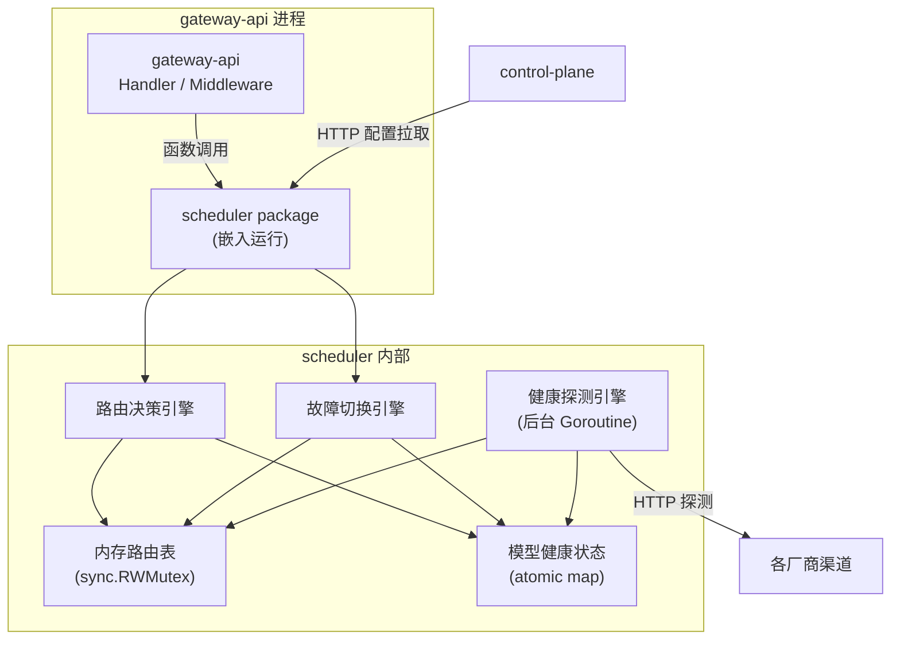

# scheduler Web 后端概要设计

## 0. 文档信息

| 属性 | 内容 |
| :--- | :--- |
| **所属变更** | CHG-20260525-001 |
| **模块名称** | scheduler |
| **模块类型** | web-backend |
| **创建时间** | 2026-05-25 |

### 修订记录

| 版本号 | 修改日期 | 修改内容摘要 | 修改人 |
| :--- | :--- | :--- | :--- |
| v1.0 | 2026-05-25 | 初稿创建 | OpenCode |

---

## 1. 技术范围界定

### 1.1 起点与终点

| 维度 | 说明 |
| :--- | :--- |
| **起点** | gateway-api 传入模型组名发起路由决策 HTTP 请求；定时器触发健康探测 |
| **终点** | 返回目标模型信息（模型标识 + 渠道连接信息）供 gateway-api 调用；输出健康状态变更事件 |
| **解决的问题** | 将路由决策、负载均衡、健康探测、故障切换从 gateway-api 解耦为独立调度层，实现模型组内多维度智能路由 |

### 1.2 技术边界

| 方向 | 依赖方 | 说明 |
| :--- | :--- | :--- |
| **上游** | gateway-api | 消费路由决策和故障切换请求 |
| **上游** | control-plane | 提供模型组配置、组内模型列表、路由策略参数 |
| **下游** | 各厂商渠道 | 健康探测的探测目标 |
| **下游** | observability-hub | 健康状态变更事件消费者 |

### 1.3 不涉及

- 模型组 CRUD（control-plane 负责）
- 鉴权与身份解析（auth + gateway-api 负责）
- 调用日志与用量统计（observability-hub 负责）
- 模型组权限管控（本次版本不做）

---

## 2. 架构方向探索

宪章已将 scheduler 定位为独立 `web-backend` 模块，与 gateway-api 通过 HTTP 接口通信；需求要求路由决策 <10ms，
内存路由表是唯一合理方案。无多方向分支，直接采用单体 Go 服务 + 内存状态 + 后台协程架构。

**选定方向**：独立 Go HTTP 微服务，内存路由表 + 后台健康探测协程 + HTTP 配置同步。

---

## 3. 架构方案

### 3.1 整体架构

**部署模式**：scheduler 作为 Go package 嵌入 gateway-api 进程内运行，不独立部署。gateway-api 通过函数调用（非 HTTP）使用 scheduler 的路由和切换能力。



### 3.2 核心流程

#### 路由决策流程

```mermaid
sequenceDiagram
    participant GW as gateway-api
    participant S as scheduler
    participant RT as 内存路由表
    participant HS as 健康状态存储

    GW->>S: POST /route {group_name}
    S->>RT: 查询组配置(策略类型、模型列表)
    RT-->>S: 策略+模型列表
    S->>HS: 过滤健康模型
    HS-->>S: 健康模型子集
    alt 策略=轮询
        S->>S: 计数器递增，按序号选择
    else 策略=优先级
        S->>S: 按优先级数值升序选择首个
    else 策略=加权
        S->>S: 按权重比例随机选择
    end
    S-->>GW: {model_id, model_name, channel_id,
            channel_endpoint, credential}
```

#### 故障切换流程

```mermaid
sequenceDiagram
    participant GW as gateway-api
    participant S as scheduler
    participant RT as 内存路由表

    GW->>S: POST /route {group_name}
    S-->>GW: {model_id: A, ...}
    GW->>GW: 调用模型 A 失败

    GW->>S: POST /failover
            {group_name, failed_model: A}
    S->>RT: 查询组内模型(排除 A)
    S->>S: 按策略选择其他健康模型
    alt 存在其他健康模型
        S-->>GW: {model_id: B, ...}
    else 无其他可用模型
        S-->>GW: {error: "no_available_model"}
    end
```

#### 健康探测流程（双机制并行）

```mermaid
sequenceDiagram
    participant GW as gateway-api
    participant API as scheduler API
    participant HS as 健康状态存储
    participant CH as 各厂商渠道

    Note over CH: ⚡ 被动检测（毫秒级）——主要
    GW->>API: POST /failover {failed_model: A}
    API->>HS: A 评分-N，连续失败达阈值则标记不健康
    API-->>GW: {model: B, ...}

    Note over CH: 🔄 主动探测（秒级）——兜底
    loop 每 30 秒
        API->>CH: HTTP 探测
        alt 响应正常
            API->>HS: 成功计数+1，达阈值则恢复健康
        else 超时/连接错误
            API->>HS: 失败计数+1，达阈值则标记不健康
        end
    end
end
```

### 3.3 组件职责

| 组件 | 职责 | 并发模型 |
| :--- | :--- | :--- |
| HTTP API Layer | 暴露路由和故障切换的**内部 Go 接口**供 gateway-api 调用（非 HTTP 端点） | 同进程函数调用 |
| 路由决策引擎 | 根据组策略+健康状态选择目标模型，维护轮询计数器 | 读多写少，sync.RWMutex |
| 故障切换引擎 | 排除已失败模型重新路由，单次最多切换一次 | 同上 |
| 配置同步器 | 定期从 control-plane 拉取模型组配置，更新内存路由表 | 后台协程，定时 HTTP 拉取 |
| 内存路由表 | 存储组→策略→模型列表的映射关系 | sync.RWMutex 保护 |
| 健康探测引擎 | 双机制：被动（调用失败即时评分降级，毫秒级）+ 主动（定时渠道探测，30s 兜底） | 每模型独立 goroutine |
| 渠道探测器 | 执行单次 HTTP 健康探测并判断结果 | 带超时的 HTTP Client |
| 健康状态存储 | 存储每个模型的健康状态和连续成功/失败计数 | atomic 操作 |
| 事件发布器 | 健康状态变更时发布事件 | 异步 channel |

### 3.4 技术选型

| 领域 | 选择 | 理由 |
| :--- | :--- | :--- |
| 语言/框架 | Go + Gin | 与网关整体技术栈一致，现有 gateway-api 和 control-plane 均为此栈 |
| 路由表存储 | 内存 map + sync.RWMutex | 路由决策 <10ms 性能要求，读多写少场景最优 |
| 健康状态存储 | 内存 atomic map | 高频读写，无需持久化（重启后重新探测） |
| 配置同步 | HTTP 定期拉取 (5s) | 简单可靠，与 control-plane 现有配置下发间隔一致 |
| 健康探测 | 后台 goroutine + time.Ticker | Go 原生并发，每模型独立探测避免互相干扰 |
| 内部通信 | Go 函数调用（直接调用 scheduler package 接口） | 嵌入 gateway-api 进程内，无需网络开销 |

### 3.5 关键数据流

| 数据 | 来源 | 消费方 | 更新频率 | 一致性要求 |
| :--- | :--- | :--- | :--- | :--- |
| 模型组配置 | control-plane HTTP API | 内存路由表 | 每 5 秒同步 | 最终一致 |
| 模型健康状态 | 渠道健康探测 | 路由决策引擎 | 每 30 秒更新 | 实时 |
| 路由决策结果 | 路由决策引擎 | gateway-api | 每次调用 | 强一致 |
| 健康状态变更事件 | 事件发布器 | observability-hub | 状态变更时 | 最终一致 |

### 3.6 错误处理与降级

| 故障场景 | 处理策略 |
| :--- | :--- |
| control-plane 不可达 | 继续使用上一次成功同步的配置，持续重试拉取 |
| 健康探测渠道超时 | 计为一次失败，不阻塞其他模型探测 |
| 组内所有模型不健康 | 返回明确错误码，gateway-api 向业务方返回可理解提示 |
| scheduler 自身故障 | gateway-api 降级为直连组内首个注册模型 |

---

## 4. 技术选型与约束

| 领域 | 选型 | 理由 |
| :--- | :--- | :--- |
| 运行时 | Go | 与 gateway-api 同进程部署，无语言差异 |
| 框架 | Gin | 与网关整体技术栈一致 |
| 路由表存储 | 内存 map + sync.RWMutex | 路由决策 <10ms 性能要求 |
| 健康状态存储 | 内存 atomic map | 高频读写，重启后重探即可 |
| 配置同步 | HTTP REST (control-plane) | 定期拉取，与现有配置下发间隔一致 |

### 宪章合规性

| 原则 | 方案是否合规 | 说明 |
| :--- | :--- | :--- |
| 原则七 分层抽象 | ✅ | 组名替代模型名，业务方不感知底层模型和渠道 |
| 原则八 智能路由 | ✅ | 三维度决策：等级（组）+ 渠道状态（健康）+ 负载（策略） |
| 原则九 高可用容错 | ✅ | 秒级健康探测 + 自动故障切换 + 每组有降级路径 |
| 原则十 负载最优 | ✅ | 轮询/优先级/加权三种策略，管理员可按场景选择 |
| 原则十一 可观测可管控 | ✅ | 健康状态变更事件发布，配置热更新无需重启 |

---

## 5. 中间件链

不适用 — scheduler 嵌入 gateway-api 进程内运行，不暴露独立 HTTP 端点，不涉及中间件链。

---

## 6. 认证与授权

不适用 — scheduler 通过 gateway-api 进程内函数调用提供服务，不暴露外部接口。配置同步从 control-plane 拉取时使用预共享 Token 认证。

---

## 7. 数据存储与外部依赖

### 7.1 主数据库

无外部数据库 — 路由表和健康状态均使用进程内存存储。

### 7.2 缓存策略

不适用 — 所有数据均在内存中，无需外部缓存层。

### 7.3 外部服务依赖

| 服务 | 用途 | 超时配置 | 降级策略 |
| :--- | :--- | :---: | :--- |
| control-plane HTTP API | 拉取模型组配置 | 5000 ms | 使用上次成功同步的缓存配置 |
| 各厂商渠道 HTTP 端点 | 健康探测目标 | 5000 ms | 计为探测失败，不影响其他渠道探测 |

---

## 8. 安全设计

| 威胁 | 防御措施 |
| :--- | :--- |
| 未授权配置篡改 | control-plane 配置同步使用预共享 Token 认证 |
| 外部暴露 | scheduler 不暴露 HTTP 端点，仅通过进程内函数调用访问 |
| 探测目标不可信 | 健康探测目标均为内部注册的渠道，非外部开放接口 |

---

## 9. 观测与运维

### 9.1 质量目标

| 指标 | 目标值 | 测试条件 |
| :--- | :---: | :--- |
| 路由决策延迟 | ≤ 10 ms | 正常负载 |
| 健康探测间隔 | 30 s | 定时器触发 |

### 9.2 日志与追踪

| 维度 | 方案 |
| :--- | :--- |
| 日志格式 | 结构化日志（JSON），记录路由决策详情、健康状态变更 |
| 事件发布 | 健康状态变更事件异步发布至 observability-hub |
| 指标采集 | Prometheus 指标：路由延迟、健康检查结果、配置同步状态 |

### 9.3 健康检查端点

不适用 — scheduler 嵌入 gateway-api 进程内，无独立 HTTP 端点。

### 9.4 监控告警

| 指标 | 告警阈值 | 通知方式 |
| :--- | :--- | :--- |
| 路由决策延迟 P99 | > 20 ms | 日志告警 |
| 所有模型不健康 | 持续超过 30 s | observability-hub 事件 |

---

## 10. 失败模式与降级策略

| 失败场景 | 影响 | 降级策略 | 恢复方式 |
| :--- | :--- | :--- | :--- |
| control-plane 不可达 | 无法获取最新配置 | 继续使用上一次成功同步的配置，持续重试拉取 | control-plane 恢复后自动拉取 |
| 健康探测渠道超时 | 该渠道探测失败 | 计为一次失败，不阻塞其他模型探测 | 下一轮探测自动重试 |
| 组内所有模型不健康 | 无法返回可用模型 | 返回明确错误码，gateway-api 向业务方返回可理解提示 | 任一模型恢复健康后自动可用 |
| scheduler 启动阶段（无配置） | 路由决策无依据 | 返回错误，gateway-api 降级为直连默认模型 | 首次配置同步完成后恢复正常 |

---

## 11. 待研究事项

无 — 全部技术方案已在详细设计阶段确定。

---

## 12. 风险与对策

| 风险 | 概率 | 影响 | 对策 |
| :--- | :--- | :--- | :--- |
| 健康探测对渠道的负载压力 | 低 | 低 | 探测请求轻量（HEAD/简单 GET），间隔 30s，对渠道几乎无影响 |
| 多 gateway 实例各自探测的重复 | 中 | 低 | 各实例独立探测，天然分担；探测请求量在渠道可接受范围内 |
| 轮询计数多实例不一致 | 高 | 低 | 各实例独立维护计数器，天然实现负载分担，无需同步 |

---

## 13. 概要设计确认

本概要设计已于 2026-05-25 经用户确认通过。

- [x] 技术范围已界定
- [x] 架构方向已探索并选定
- [x] 架构方案已确认
- [x] 技术选型符合宪章
- [x] 待研究事项已识别

👉 确认后进入详细设计阶段（`/xf/detail`）